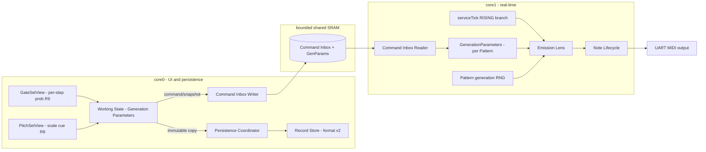

# Design Document: Generative Engine Expansion — Stream Constraints

## Overview

This slice turns GenSeq's three independent generative streams into a constrainable, coherent
engine without adding time-evolving mutation. It introduces a single new per-Pattern value
object — **Generation Parameters** — that bounds and shapes what the existing PitchSet,
VelocitySet, and GateSet emit, and it exposes every one of those parameters through the existing
matrix-UI interaction vocabulary.

The design holds one principle above all others: **everything new is a lens applied at
emission, never a rewrite of the streams.** `PitchSet`, `VelocitySet`, and `GateSet` keep their
current roles, storage, and traversal. A Scale Constraint, a Step Probability roll, a velocity
perturbation, or a coupling rule is computed *between* a stream's stored value and the MIDI
note-on — at exactly one place in the code: the RISING-flank branch of
`Sequencer::serviceTick()` in `src/sequencer/sequencer.cpp`, where today

```cpp
noteLifecycle.noteOn(id, pattern.getCanonicalChannel(),
                     pitchSet.getPitch(), velocitySet.getVelocity());
```

becomes a call that first runs the Pattern's Generation Parameters over those two bytes and the
gate decision. Because the lens sits at emission, it composes automatically with RANDOM playing
order and with any future mutation operator, and it guarantees the behavior-preserving default
(no scale / 100% / zero humanization / independent coupling) reproduces today's output byte for
byte.

The design is driven by five invariants, inherited from and extending Milestone 2:

1. A Generation Parameters set with default values emits output identical to pre-milestone GenSeq.
2. All stochastic behavior for a Pattern derives from one owned generation random state, so a
   seed reproduces the whole Pattern, not one stream.
3. The emission lens is bounded and allocation-free on the core1 Hot Path.
4. Every parameter has a matrix-UI set/adjust/clear path; none is reachable only through tooling.
5. A parameter change during playback flows through the Milestone 2 command/snapshot path at a
   musical boundary and never strands a note.

## Current-State Findings

The existing code has clean seams for all of this, with three constraints that shape the design:

- **Emission is centralized.** `Sequencer::serviceTick()` is the only producer of note-ons. The
  RISING branch forms a note-on from `pitchSet.getPitch()` / `velocitySet.getVelocity()`; the
  FALLING branch releases and advances. This is the single hook for R1/R2/R3. Reconciled
  (missed) ticks already suppress note-ons — the probability roll must integrate with that path
  so a suppressed-by-probability step behaves like a suppressed-by-reconcile step for lifecycle
  purposes (advance, no strand).
- **The Hot Path carrier is a POD.** `sequencer::PatternSnapshot` (`src/sequencer/PatternSnapshot.h`)
  is a fixed-capacity, heap-free struct precisely so the core1 receive/apply path never
  allocates (M2 Req 7.9). Generation Parameters must ride the same POD discipline: fixed-size
  fields, no `std::vector`, decoded in place.
- **Persistence is versioned and strict.** `persistence::serialize/deserialize`
  (`src/persistence/SaveRecord.cpp`) use `FORMAT_VERSION = 1` and reject any other version with
  `BAD_VERSION` — there is no migration path today. R6.5 ("a saved Pattern from before this
  milestone SHALL load with defaults") therefore *requires* a version bump to 2 plus a
  back-compatible decoder, replacing the hard `BAD_VERSION` rejection of v1 records with a
  defaulting load.
- **Both target views are property editors.** `GateSetProperty` (ALGORITHM/STEPS/PULSES/
  ROTATION/NOTE_LENGTH/LENGTH) in `src/ui/state/UIState.h` and the `PITCH_SET_FIELD_*` index
  scheme are the exact vocabulary R9/R10 reuse. The PitchSet view already renders a note name per
  position (R8's overlay target). `setPixel(15,0,...)` is the existing dirty-draft pixel R8 must
  stay distinct from.
- **The RANDOM LCG is per-stream.** `PitchSet::randomState` (0x12345678) and
  `VelocitySet::randomState` (0x87654321) are seeded by constants and advance independently. R4
  consolidates the *concept* of randomness ownership to the Pattern; the design must do this
  without changing existing RANDOM-order output when no seed is set (to keep
  `property2_sequencer_equivalence` valid).

## Goals and Non-Goals

### Goals

- One per-Pattern Generation Parameters value object, defaulting to behavior-preserving values.
- Scale/key constraint with four quantization modes, applied at emission.
- Per-Pattern and per-step Step Probability with an explicit inherit state.
- Bounded, clamped velocity humanization.
- One Pattern generation random state driving RANDOM order, probability, and humanization, with
  explicit-seed determinism across runs and save/load.
- Independent and locked stream coupling with a defined length-reconciliation rule.
- A matrix-UI control for every parameter (R10), reusing the existing view vocabulary.
- Persistence format v2 with a back-compatible v1-loads-as-defaults decoder.
- Host and RP2040 validation proving byte-identical default behavior and determinism.

### Non-Goals

- Time-evolving mutation / variation operators (next slice).
- New scales beyond a defined extensible representation (chromatic/major/minor minimum).
- Richer coupling vocabularies beyond independent/locked (ratio, pitch-drives-density, etc.).
- Final hardware controls or interaction-design ergonomics (later milestone).
- Any change to MIDI transport, outputs, routing, or CC generation.

## Architecture

Generation Parameters are owned by core0 Working State (editable, saved) and projected onto
core1 as part of the existing snapshot handoff. The emission lens runs on core1 only.



## Component Design

### 1. GenerationParameters value object

A POD, fixed-size, SDK-free struct owned per Pattern. No `std::vector`, no heap. Lives in
`src/common/GenerationParameters.h` so both core0 Working State and the core1 snapshot can hold
it identically, and host tests compile it unchanged.

```cpp
namespace common {

enum class ScaleId : uint8_t { CHROMATIC = 0, MAJOR, MINOR_NATURAL /* extensible */ };
enum class QuantizeMode : uint8_t { NEAREST = 0, DOWN, UP, SKIP };
enum class CouplingMode : uint8_t { INDEPENDENT = 0, LOCKED };

// Per-step probability uses a sentinel for the "inherit per-Pattern" state so an
// explicit 100% is distinguishable from "not set" (R9 AC3). Values 0..100 are an
// explicit percent; INHERIT means fall back to the per-Pattern value.
static constexpr uint8_t STEP_PROB_INHERIT = 0xFF;

struct GenerationParameters {
    // --- Scale constraint (R1) ---
    ScaleId scale = ScaleId::CHROMATIC;      // CHROMATIC == no constraint == default
    uint8_t scaleRoot = 0;                   // pitch class 0..11 (0 == C)
    QuantizeMode quantize = QuantizeMode::NEAREST;

    // --- Step probability (R2) ---
    uint8_t patternProbability = 100;        // 0..100 percent; 100 == default
    // Per-step overrides, parallel to gate steps. INHERIT == use patternProbability.
    // Sized to the UI step cap (16), not the raw gate-tick cap, since probability
    // is a per-programmed-step property, not a per-tick one.
    static constexpr uint8_t kMaxSteps = 16;
    uint8_t stepProbability[kMaxSteps];      // all STEP_PROB_INHERIT by default

    // --- Velocity humanization (R3) ---
    uint8_t humanizeRange = 0;               // +/- amount; 0 == default

    // --- Determinism (R4) ---
    bool seedSet = false;                    // false == default (free-running)
    uint32_t seed = 0;

    // --- Coupling (R5) ---
    CouplingMode coupling = CouplingMode::INDEPENDENT;  // default

    GenerationParameters() { for (auto& s : stepProbability) s = STEP_PROB_INHERIT; }

    // True when every field is at its behavior-preserving default. The emission
    // lens short-circuits on this so the default path is provably identical and
    // adds near-zero Hot Path cost (invariant 1 + 3).
    bool isDefault() const;
};

} // namespace common
```

Rationale for the shapes:

- **`ScaleId` enum, not a bitmask, in storage** — but the *runtime* scale is expanded once (on
  parameter change, core1) into a 12-bit pitch-class membership mask held in the Pattern runtime.
  Storing an id keeps the persistence format stable when scales are added (R1.6); expanding to a
  mask keeps the per-note membership test O(1) and allocation-free (R6.1).
- **`STEP_PROB_INHERIT = 0xFF` sentinel** — the one clean way to make "inherit" distinct from an
  explicit 100% (R9 AC3) in a single byte, with no parallel "is-set" array.
- **`kMaxSteps = 16`** matches `MAX_PITCHES` / UI step editing granularity, not
  `PatternSnapshot::kMaxGateSteps` (6144). Per-step probability is a property of a *programmed
  step*, so it is bounded by the editable step count, keeping the struct small (16 bytes for the
  array) and the snapshot footprint bounded.

### 2. Scale model and the emission lens

A free function library in `src/common/Scale.{h,cpp}`, SDK-free and host-tested:

```cpp
namespace common::scale {
    // 12-bit membership mask for a (ScaleId, root) pair. Bit i set => pitch class
    // ((i)) is in scale. CHROMATIC => 0x0FFF (all in scale).
    uint16_t membershipMask(ScaleId id, uint8_t root);

    // Is MIDI note `n` in the scale described by `mask`?
    bool inScale(uint16_t mask, uint8_t n);

    // Resolve note `n` to an in-scale note per `mode`. Returns false for SKIP
    // when `n` is out of scale (caller suppresses the step). NEAREST/DOWN/UP
    // always return true with a resolved note, searching at most 12 semitones.
    bool quantize(uint16_t mask, QuantizeMode mode, uint8_t n, uint8_t& out);
}
```

The **emission lens** is a single core1 method, `Sequencer::emitStep(...)`, invoked from the
RISING branch of `serviceTick`. Pseudocode, evaluated allocation-free in this fixed order so
determinism and lifecycle are exact:

```
emitStep(patternIndex, id, channel, gateStepIndex):
    gp = genParams[patternIndex]
    if gp.isDefault():
        noteLifecycle.noteOn(id, channel, pitchSet.getPitch(), velocitySet.getVelocity())
        return EMITTED

    rng = patternRng[patternIndex]              // R4: one state per pattern

    # R2: probability roll (per-step override else per-pattern)
    p = gp.stepProbability[gateStepIndex]
    if p == INHERIT: p = gp.patternProbability
    if p < 100 and rng.rollPercent() >= p:
        return SUPPRESSED                       # advance handled by caller, no note-on

    # R1: scale constraint
    note = pitchSet.getPitch()
    if gp.scale != CHROMATIC:
        if not scale::quantize(mask[patternIndex], gp.quantize, note, note):
            return SUPPRESSED                    # SKIP mode, out of scale

    # R3: velocity humanization, clamped 1..127
    vel = velocitySet.getVelocity()
    if gp.humanizeRange > 0:
        vel = clamp(vel + rng.signedRange(gp.humanizeRange), 1, 127)

    noteLifecycle.noteOn(id, channel, note, vel)
    return EMITTED
```

Critical ordering decisions:

- **Probability is rolled before scale/humanization.** A suppressed step consumes exactly one
  probability draw and no pitch/velocity draw, so the RNG stream stays aligned regardless of
  whether later stages would have drawn. This keeps seeded replay identical (R2.5, R4).
- **SKIP and probability-suppression take the same lifecycle path** — the caller treats a
  `SUPPRESSED` return exactly as the existing reconcile path treats a missed onset: advance pitch/
  velocity positions as usual on the FALLING edge, never emit a note-on, never strand a prior
  note (R1.4, R2.2, R6.3). This is why the lens returns a status rather than emitting
  conditionally inline.
- **`isDefault()` short-circuit** guarantees the no-feature path is byte-identical and O(1), so
  the existing `property5_midi_stream` / `property2_sequencer_equivalence` tests stay valid as
  regression guards (invariant 1).

> **OPEN ISSUE — per-step probability index model (resolve in Task 9).** The per-step probability
> array (`stepProbability[kMaxSteps]`, 16 entries) is a property of a *programmed step*, but the
> lens currently indexes it by `GateSet::getPosition()`, which is a *tick* position running to the
> full gate-array length (up to 64×96 ticks via the Euclidean `stepLength`), NOT the 0..15
> programmed-step index. The two only coincide for a gate array of ≤16 ticks. This is latent today
> (no UI sets `stepProbability`, and the Task 4 tests exercise only per-Pattern probability), but
> it must be fixed when the Task 9 grid defines the programmed-step index. The resolution: the
> GateSet view's grid is addressed by programmed step (0..STEPS-1), and the lens must map the
> current tick position to its owning programmed step (or the gate array must carry a parallel
> per-step probability aligned to the *edit grid*, not the tick array) so the value the user edits
> on step N governs the onset that step N produces. Settle this at the top of Task 9 before wiring
> the grid; the per-Pattern probability path is unaffected.

### 3. Pattern generation random state (R4)

Add one `PatternRng` per Pattern runtime on core1 — a named LCG with explicit seeding:

```cpp
struct PatternRng {
    uint32_t state;
    void seed(uint32_t s);        // defined function of the seed (R4.2)
    uint8_t rollPercent();        // 0..99, one draw
    int8_t signedRange(uint8_t r);// uniform in [-r, +r], one draw
    uint32_t next();              // raw LCG step (also feeds RANDOM order when seeded)
};
```

Randomness-ownership decision (the requirement I flagged as highest-risk):

- **When no seed is set (`seedSet == false`):** the existing per-stream LCGs in `PitchSet` /
  `VelocitySet` are left exactly as they are. RANDOM playing order output is unchanged, so
  `property2_sequencer_equivalence` holds byte-for-byte. The `PatternRng` is used only for
  probability and humanization, seeded from a defined default (R4.4) — and since probability==100
  and humanize==0 are the defaults, a no-feature Pattern draws from it zero times.
- **When a seed is set:** the Pattern reseeds its `PatternRng` at the defined musical boundary
  (next bar on Play / seed-change), and RANDOM-order streams are re-routed to draw from the
  Pattern RNG so the *entire* Pattern (order + probability + humanization) is reproducible
  (R4.1, R4.3). This re-route is gated strictly behind `seedSet`, so it never affects the
  unseeded default path.

This gives R4 its headline property (a seed reproduces the whole Pattern) without changing any
existing output when seeds are unused.

### 4. Stream coupling (R5)

Coupling changes only *which position* the velocity (and optionally gate-derived) stream reads,
never the note lifecycle. Two modes:

- **INDEPENDENT (default):** every stream advances on its own position exactly as today (R5.3).
- **LOCKED:** on each emitted step the VelocitySet position is driven from the PitchSet position
  rather than advanced independently. Length reconciliation rule (R5.4): the follower index is
  `pitchSet.getPosition() % velocityCount` — a defined modulo map that is bounded, allocation-
  free, and never strands a note. The pitch stream remains the phrase leader; gate rhythm stays
  independent in this slice (gate coupling beyond rhythm is deferred with the richer vocabulary).

Coupling is applied inside `emitStep` before reading velocity, and only affects reads, so the
FALLING-edge release path is untouched.

### 5. Hot Path application and the snapshot (R6)

Generation Parameters reach core1 through the existing bounded command/snapshot path:

- Extend `sequencer::PatternSnapshot` with a `GenerationParameters` member (POD, fixed-size —
  honours the existing no-allocation discipline; its `footprintBytes()` grows by
  `sizeof(GenerationParameters)` ≈ 16-byte step array + ~10 scalar bytes).
- Add a `GEN_PARAMS_SET` command (or fold into the existing per-set commands) so a parameter edit
  is applied at a defined boundary (next beat for probability/humanize/scale; next bar for
  coupling and seed, which affect phrase structure) via the M2 pending-operation mechanism
  (R6.2, R10.5).
- On apply, core1 expands `ScaleId`+root into the 12-bit mask once and stores it in the Pattern
  runtime, so per-note tests never recompute it.

The emission lens performs no allocation and bounded work (one mask lookup, at most two RNG
draws, at most a 12-semitone quantize search), satisfying R6.1. Timing-fault fail-closed (R6.4)
is unchanged — the lens lives entirely inside the already-guarded tick service.

### 6. Persistence format v2 (R6.5)

Bump `FORMAT_VERSION` from 1 to 2 and append Generation Parameters per Pattern to the payload,
after the existing `midiChannel`/`active` bytes, in `src/persistence/SaveRecord.cpp`:

```
per-pattern GenerationParameters block (appended):
  u8  scale            u8  scaleRoot       u8  quantizeMode
  u8  patternProbability
  u8  humanizeRange
  u8  seedSet          u32 seed (LE)
  u8  coupling
  u8  stepProbCount    u8[stepProbCount] stepProbability   (count-driven, like pitches)
  u8  gateStepCount    bit-packed gate states, ceil(gateStepCount/8) bytes   (R9 manual gates)
```

The **explicit gate array is new to the format**: v1 stored only the Euclidean generator
parameters and re-derived the gate array on load. Manual per-step gate editing (R9.2) means the
gate array can diverge from what the generator parameters would produce, so v2 must persist the
actual gate states, not just the generator seed. The generator parameters are still stored (they
remain the editable seed and the UI shows them), but the gate array is now authoritative on load.

Migration contract — the load path replaces today's hard `BAD_VERSION` rejection of non-current
versions with explicit handling:

- **version == 2:** decode the appended block per Pattern.
- **version == 1:** decode the v1 payload exactly as today, then set every Pattern's
  Generation Parameters to their behavior-preserving defaults (scale=CHROMATIC, prob=100,
  humanize=0, seedSet=false, coupling=INDEPENDENT, all steps INHERIT). This is R6.5's "loads with
  defaults" — a v1 save remains loadable, not rejected.
- **version > 2 or unknown:** still `BAD_VERSION`.

The CRC/header machinery, the local-decode-then-assign discipline (never mutate `out` on
failure), and the count-driven `ReadCursor` bounds-guard are all preserved. A v2 save round-trips
Generation Parameters unchanged (R1.7, R2.6, R5.5, R9.6).

### 7. PitchSet view — scale membership cue (R8)

A read-only overlay on the existing `PitchSetView::render`. When a pitch position field is
selected (`selectedPitchSetField >= PITCH_SET_FIELD_PITCH_BASE`) and the Pattern's scale is not
CHROMATIC, the view computes `scale::inScale(mask, displayedPitch)` — using the *same*
`common::scale` library the sequencer uses at emission (R8.4, the no-disagreement guarantee) —
and lights a dedicated indicator pixel.

Decisions:

- **Indicator location:** a reserved pixel distinct from the dirty-draft pixel at `(15,0)` — e.g.
  `(14,0)` — so in-scale vs out-of-scale never aliases the draft indicator (R8.2). In-scale and
  out-of-scale are two states of that pixel (on/off, or two colors if the matrix supports it);
  the note-name render is untouched (R8.2).
- **Pure overlay:** when scale == CHROMATIC the render is byte-identical to today (R8.5), and the
  cue reads state only — it never writes the draft, commit, or undo path (R8.6). It updates on
  field move / value adjust within the M2 UI responsiveness bound (R8.3).
- The scale itself is *not* edited in PitchSet view in this slice; the cue is feedback for a scale
  set elsewhere (see R10 control map). This keeps R8 strictly read-only.

### 8. GateSet view — per-step gate and probability grid editor (R9)

This is the largest UI change in the slice. The GateSet view today is **generator-only**: its
properties (ALGORITHM/STEPS/PULSES/ROTATION/NOTE_LENGTH/LENGTH) drive `createEuclidean`, which
*produces* a gate array; there is no way to hand-edit an individual step, and per-step
probability does not exist. The user's workflow — "(optionally) use the Euclidean circles
generator, then manually walk each step and set gate and probability individually" — requires
turning the view into a two-stage editor: **generator properties, then a per-step grid** where
every step carries both an editable gate state and an editable probability.

This folds in **manual gate editing**, which did not exist before (the gate array was only ever
generator-produced). That is a deliberate scope addition: per-step probability is only meaningful
if the performer can also decide which steps gate, so the two edit together in one place.

**View structure — two field classes, one property cursor.** Keep the existing generator
properties, then append a per-step grid addressed by field index, mirroring the proven
`PITCH_SET_FIELD_*` scheme (`src/ui/state/Reducer.cpp` `movePitchSetField`/`adjustPitchSetValue`):

```
GateSetProperty / field cursor order:
  ALGORITHM, STEPS, PULSES, ROTATION, NOTE_LENGTH, LENGTH,   // generator (unchanged)
  STEP_BASE + 0, STEP_BASE + 1, ... STEP_BASE + (steps-1)    // one field per step
```

`moveGateSetProperty` (LEFT/RIGHT) walks across generator fields and then step-by-step through
the grid; the last step field is `STEP_BASE + draft.steps - 1`, so the grid length tracks the
generator's `STEPS` value exactly. This keeps the single-axis move/adjust vocabulary already in
`GateSetView::handleEvent` — no new 2-D editor, no modal menu (R9.1).

**Editing a step — gate and probability on one field.** Each step field edits two values. The
established one-axis adjust is split by modifier, reusing the SHIFT/`coarse` convention already in
`handleEvent`:

- **UP/DOWN** cycles that step's probability: `INHERIT → 0% → 10% → … → 100%`, INHERIT as a
  distinct first state (R9.5), coarse (SHIFT) steps by larger increments.
- **ENTER on a step** toggles that step's gate on/off (R9.2) — reusing the existing ENTER key,
  which in generator fields commits; on a step field it is the natural "set this step" action.
  Commit of the whole draft remains ENTER from a generator field / an explicit commit, consistent
  with the existing `commitGateSetEdit`. (Alternative: a dedicated toggle key; ENTER-on-step is
  chosen to avoid adding a key.)

**Gate storage — the grid owns the gates, the generator seeds them.** Today `GateSetConfig` holds
only generator parameters and the gate array is derived in `sendGateSet`. To support manual edits
the draft must carry an explicit per-step gate array that the generator *writes into* rather than
solely deriving:

- Applying/adjusting a generator property runs `createEuclidean` and writes its result into the
  draft's gate array (R9.3) — this is the "optional seed" step.
- A manual gate toggle edits that array directly, layering on top of the generated seed.
- **Generator re-apply policy (R9.3):** re-touching a generator property regenerates the **gate
  states** (manual gate edits since the last generate are overwritten — the generator is a
  reseed), but **per-step probability values are preserved** across a regenerate, since
  probability is indexed by step position and the step count is what the generator changes. When
  `STEPS` shrinks, probability entries beyond the new length are retained in storage but inert;
  when it grows, new steps default to INHERIT. This rule is stated so the workflow is
  predictable: generate to lay down rhythm, then shape gates and probabilities, and a later
  regenerate only re-lays the rhythm.

**Byte-identical default (R9.7).** A gate pattern built only through the generator with no manual
toggle produces the same gate array `createEuclidean` produces today, and with all probabilities
at INHERIT and per-Pattern probability 100% the emission is unchanged. The grid is additive: its
presence does not alter generator-only output.

**Matrix feedback (R9.6).** The grid renders as a step row: each step's gate shown as lit/unlit,
the currently-edited step highlighted, and the edited step's probability shown as a coarse level
bar (per R7.3, since full percent exceeds matrix resolution). INHERIT renders distinctly from an
explicit level (e.g. a dim marker vs a level bar).

**State and persistence.** The explicit gate array and the per-step probability array both live in
the GateSet draft / `GateSetConfig` Working State, flow through the existing draft/commit/undo and
`sendGateSet` command path, ride the `PatternSnapshot` + `GenerationParameters` added in §5
(bounded, allocation-free), and persist via the §6 v2 format (R9.8). Both arrays are sized to the
step cap (`GenerationParameters::kMaxSteps`, and the existing gate editing cap of 64 steps for
gates) and are POD — no heap on the Hot Path.

### 9. R10 control map — one simple control per parameter

R10 requires that *every* Generation Parameter has a bounded, stated matrix-UI set/adjust/clear
path, reusing the move/adjust/commit/undo vocabulary, with a clear-to-default. The map:

| Parameter | View / host field | Interaction | Clear-to-default | Actions from default |
|---|---|---|---|---|
| Scale id | PitchSet view, new `SCALE` field (before pitch fields) | move→field, adjust cycles CHROMATIC/MAJOR/MINOR | set to CHROMATIC | ≤2 (move, adjust) |
| Scale root | PitchSet view, new `ROOT` field | adjust cycles 0..11 | N/A when CHROMATIC | ≤2 |
| Quantize mode | PitchSet view, new `QUANTIZE` field | adjust cycles NEAREST/DOWN/UP/SKIP | NEAREST | ≤2 |
| Per-Pattern probability | GateSet view, new `PROBABILITY` field | adjust 0..100 (coarse) | set to 100 | ≤2 |
| Per-step gate | GateSet view, per-step grid field (R9) | move to step, ENTER toggles on/off | regenerate / toggle back | ≤2 |
| Per-step probability | GateSet view, per-step grid field (R9) | move to step, UP/DOWN cycles incl. INHERIT | set to INHERIT | ≤3 |
| Humanize range | VelocitySet view, new `HUMANIZE` field | adjust 0..N | set to 0 | ≤2 |
| Seed | Settings/Pattern view, `SEED` field | adjust value; a dedicated "no seed" state clears | set to seedSet=false | ≤2 |
| Coupling | Pattern/Settings view, `COUPLING` field | adjust cycles INDEPENDENT/LOCKED | INDEPENDENT | ≤2 |

Every row reaches a default state through the UI (R10.3), uses only the established vocabulary
(R10.2), has a small stated action count (R10.4), and applies live via the command/snapshot
boundary path (R10.5). No parameter is tooling-only (R10.1); a parameter implemented in the
engine without its row's demonstrated set-and-clear path is incomplete for this milestone (R10.6).

Scale lives in the PitchSet view (where pitches are programmed, pairing with the R8 cue);
probability lives in the GateSet view (where triggers are defined, per the user's direction and
R9); humanize lives in the VelocitySet view (where velocities are programmed). Seed and coupling
are Pattern-scope, not stream-scope, so they sit in a Pattern/Settings field rather than inside a
single stream's editor.

## Error Handling

| Condition | Behavior |
|---|---|
| Out-of-scale pitch, SKIP mode | Suppress note-on, advance positions, no strand (R1.4) |
| Probability roll suppresses step | Advance positions like a reconciled miss, no note-on, no strand (R2.2) |
| Humanized velocity would be 0 or >127 | Clamp to 1..127 (R3.2) |
| Seed set mid-phrase | Reseed at next defined boundary, not inline (R4.2) |
| Coupling length mismatch | `position % followerCount` modulo map, bounded (R5.4) |
| Gen param change during playback | Applied via M2 pending-operation boundary path (R6.2) |
| Load of a v1 (pre-milestone) record | Decode v1, set Gen Params to defaults (R6.5) |
| Load of an unknown/future version | BAD_VERSION, retain previous committed record |
| Timing Fault with active Gen Params | Fail closed exactly as M2 (R6.4) |
| Engine param with no UI path | Milestone-incomplete (R10.6) |

## Testing Strategy

### Host tests

- **Default-equivalence (invariant 1):** a Pattern with default Generation Parameters produces a
  byte-identical MIDI stream to pre-milestone output — assert via the existing
  `property5_midi_stream` / `property2_sequencer_equivalence` harnesses, now run with a default
  `GenerationParameters` in place.
- **Scale constraint:** every quantization mode over major/minor/chromatic; octave preservation
  (R1.2); SKIP suppresses without stranding; chromatic == passthrough (R1.5).
- **Step probability:** per-pattern and per-step; inherit vs explicit 100%; suppressed step keeps
  phrase length and strands no note; 100% == every gated step (R2.1-2.5).
- **Velocity humanization:** bounded range, clamp floor 1 and ceiling 127, zero == passthrough
  (R3.1-3.3).
- **Determinism (R4):** same seed ⇒ identical trigger/suppress + humanized-velocity + RANDOM-order
  sequence across runs and across a serialize→deserialize round-trip; unseeded path leaves
  existing RANDOM output unchanged.
- **Coupling:** independent == today; locked drives velocity index from pitch position; mismatched
  lengths use the modulo rule with no strand (R5).
- **Allocation:** extend `example_steady_state_allocation` to prove the emission lens allocates
  nothing on the Hot Path under every parameter combination (R6.1).
- **Persistence v2:** round-trip all Generation Parameters; a hand-built v1 record loads with
  defaults (R6.5); CRC/truncation guards still hold; `out` untouched on failure.
- **Views:** PitchSet membership cue matches `scale::inScale` and is absent when chromatic, never
  touching draft/commit (R8); GateSet per-step grid lets each step toggle gate (R9.2) and cycle
  probability INHERIT/explicit (R9.4-5), the generator reseeds gate states while preserving
  per-step probability (R9.3), a generator-only pattern is byte-identical to today's
  `createEuclidean` output (R9.7), and edits commit via the draft path and survive save/load
  (R9.8).
- Sanitizer (ASan/UBSan) runs over the new value object, scale library, and persistence decoder.

### Hardware tests

On the RP2040 bench (logic analyzer on MIDI TX GPIO8 + trace GPIOs), under worst-case live load:

- Default Generation Parameters: confirm no new per-tick cost and unchanged timing vs the M2 soak.
- Each feature live-toggled via its R10 control: confirm the change applies at the boundary with
  no stuck note and within the UI responsiveness bound.
- Determinism on silicon: a seeded Pattern reproduces the same decoded MIDI across a power-cycle +
  load.
- Re-run the M2 acceptance gates (save transparency, UI-loop bound, stuck-note count) with
  Generation Parameters active to prove no regression of any M2 invariant (R6).

Milestone evidence includes the default-equivalence proof, the determinism round-trip capture,
the per-feature boundary-apply captures, the allocation report, and the persistence-migration
test record.

## Implementation Sequence

1. `GenerationParameters` value object + `isDefault()`, with host unit tests.
2. `common::scale` library (membership mask, inScale, quantize) with host tests.
3. Emission lens `Sequencer::emitStep` + `SUPPRESSED` lifecycle integration; default short-circuit;
   default-equivalence host test green.
4. `PatternRng` + determinism wiring (unseeded leaves streams untouched; seeded re-routes order).
5. Velocity humanization and scale constraint through the lens; coupling read-side map.
6. Snapshot + command/boundary plumbing for Generation Parameters (Hot Path allocation-free).
7. Persistence format v2 + v1-loads-as-defaults migration; round-trip + migration tests.
8. PitchSet membership cue (R8); PitchSet scale/root/quantize control fields (R10).
9. GateSet view: explicit gate array in the draft; per-step grid editor with manual gate toggle
   (R9.2) and per-step probability cycling (R9.4); generator-reseeds-gates-preserves-probability
   policy (R9.3); per-Pattern probability field (R10).
10. VelocitySet humanize field, Pattern-scope seed + coupling fields (R10); full R10 control-map
    verification.
11. Host suite green under sanitizers; RP2040 bench gate incl. M2 no-regression soak.
