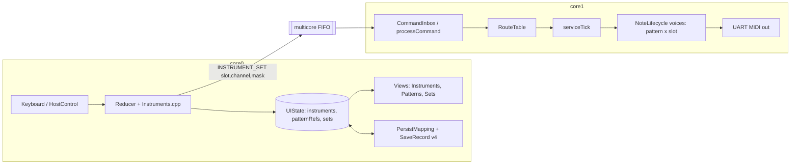

# Design Document

> **Change after review (2026-11-21).** The per-route enable flag (`InstrumentConfig::enabled`,
> key E, `toggleInstrumentRoute`, the red "route off" cell, the `NOT_MEMBER` notice) was removed:
> its MIDI result was the same as unassigning the pattern. core0 now folds `members AND NOT muted`.
> The v4 save record keeps its `enabled` field for compatibility: it is written equal to
> `members`, and on load `members & enabled` becomes the Pattern Selection, so a pattern that was
> switched off in an older v4 save loads as not assigned and stays silent. The `D:ins=` dump line
> is now `slot:ch:muted:members`. Sections below that mention `enabled` or E describe the first
> implementation.

## Overview

An **Instrument** is a new layer above patterns. It owns one MIDI channel, one mute flag and two
pattern bitmasks: `members` (the patterns assigned to it) and `enabled` (the patterns whose route
in this Instrument is switched on). Patterns lose their own MIDI channel. A pattern can be a
member of any number of Instruments and then plays on all of their channels.

The design keeps three principles of the existing code:

- **core0 owns the model, core1 owns playback.** The UI keeps the Instruments in `UIState`.
  core1 gets a small routing table through one new command and never reads UI state.
- **Fail silent.** Every ordering of commands that can reach core1 is safe: a pattern without a
  route plays nothing, so a half-applied edit can only be silent, never on a wrong channel.
- **Behaviour-preserving defaults.** One Instrument on channel 1 that contains all patterns with
  all routes enabled produces exactly today's MIDI stream. The golden stream test
  (hash `0x6e772345f8af0f79`, 1304 bytes) is the proof.

Three independent switches decide whether a note sounds (Requirement 4.9):

```
sounds(pattern p, instrument i) = active(p) AND enabled_i(p) AND NOT muted_i   (p in members_i)
```

core0 folds `members AND enabled AND NOT muted` into one mask per Instrument and sends only that
mask. core1 has no concept of mute or enable. `active` stays a per-pattern flag on core1, as today.

Decisions this design takes beyond the requirements:

| Decision | Choice | Why |
|---|---|---|
| Route state on core1 | One `RouteTable` (16 channels, 16 masks) in `sequencer` | Small, allocation-free, SDK-free, host-testable |
| Command | One new command `INSTRUMENT_SET` (header word + mask word) | One command is atomic on core1, so no batch frame is needed |
| Pattern removal | core1 and core0 both compact the masks with one shared function | Removal and mask shift are then atomic on core1 |
| Mute and route enable | Folded by core0 into the sent mask | core1 stays simple |
| Active pattern without a route | Still advances its steps and still draws random numbers | Enabling a route resumes in phase (R3.13) and seeded output does not depend on routing (R9.7) |
| Note ownership key | (pattern, Instrument slot) | Channels are unique, so a slot identifies a channel; the recorded channel handles channel changes |
| Channel change while sounding | Release that Instrument's sounding notes at apply time | Note Off goes out on the channel recorded for the Note On (R2.5) |
| Status LED | Moves from `InitView` to `UIController` | `InitView` is the only place that drives it today |

## Architecture



Data flow of one edit, "mute Instrument 2": the reducer flips `muted`, computes
`effective = muted ? 0 : members & enabled`, sends `INSTRUMENT_SET(slot 2, channel, effective)`.
core1 releases the voices of patterns that left the mask, then stores the new mask.

## Components and Interfaces

### 1. Shared routing model (`src/common/InstrumentRouting.h`, new, SDK-free)

```cpp
namespace common {
constexpr uint8_t MAX_INSTRUMENTS = 16;      // one per MIDI channel (R1.1)
constexpr uint8_t MAX_ROUTE_PATTERNS = 15;   // mirrors MAX_PATTERNS

// Drops bit `index` and shifts the higher bits down: the mask update for removing pattern `index`.
constexpr uint16_t removePatternBit(uint16_t mask, uint8_t index);

// core1's view of the routing. `channel[s]` is a protocol channel 0..15; `patterns[s]` is the
// effective mask of patterns that sound on slot s. `routes[p]` is the transpose (bit s set ==
// pattern p sounds on slot s), rebuilt whenever a slot changes.
struct RouteTable {
    uint8_t  channel[MAX_INSTRUMENTS];
    uint16_t patterns[MAX_INSTRUMENTS];
    uint16_t routes[MAX_ROUTE_PATTERNS];
    void reset();                         // slot 0: channel 0, pattern 0; all else empty
    void set(uint8_t slot, uint8_t channel, uint16_t mask);   // rebuilds routes[]
    void removePattern(uint8_t index);    // uses removePatternBit on every slot
};
}
```

`reset()` reproduces the pre-feature core1 boot state (one pattern on channel 1) so core1 plays
sensibly before the UI has sent anything, and every existing host test that builds a `Sequencer`
keeps its meaning.

### 2. UI state model (`src/ui/state/UIState.h`)

```cpp
constexpr uint8_t MAX_INSTRUMENTS = 16;
static_assert(MAX_INSTRUMENTS == common::MAX_INSTRUMENTS);

struct InstrumentConfig {
    uint8_t  channel = 1;      // user channel 1..16, unique among occupied Instruments
    bool     muted = false;
    uint16_t members = 0;      // bit p: pattern p is assigned
    uint16_t enabled = 0;      // bit p: route of pattern p is on; only bits in `members` matter
};

enum class InstrumentNotice : uint8_t { NONE, FULL, LAST_INSTRUMENT, NO_FREE_CHANNEL, NOT_MEMBER };
```

`UIState` gains:

```cpp
std::array<InstrumentConfig, MAX_INSTRUMENTS> instruments{};   // slot 0 = {1, false, 0x0001, 0x0001}
uint16_t instrumentOccupied = 0x0001;                          // bit s: slot s is occupied
uint8_t  selectedInstrument = 0;                               // always an occupied slot
uint8_t  instrumentCursor = 0;                                 // pattern cursor, 0..MAX_PATTERNS-1
InstrumentNotice instrumentNotice = InstrumentNotice::NONE;
```

Footprint: 16 x 6 bytes + 6 = about 100 bytes. All reducer functions mutate `UIState` in place
(core0 has a 2 KB stack and `UIState` must never be copied by value, see the existing comments in
`PersistMapping.h`).

Invariants (checked by a debug-build `validateInstruments()` used in tests):

1. `instrumentOccupied != 0`; `selectedInstrument` is occupied.
2. Occupied channels are pairwise different and within 1..16.
3. `enabled` and `members` have no bit at or above `patternCount`, and `enabled` is a subset of
   `members`. Operations that add or remove a member set or clear the `enabled` bit with it.

### 3. Reducer (`src/ui/state/Instruments.{h,cpp}`, new)

Same pattern as `SetLibrary.cpp`: free functions in `ui::state`, in place, notices through
`instrumentNotice`.

| Function | Behaviour | Requirement |
|---|---|---|
| `createInstrument(s)` | Lowest free slot, lowest free channel, empty masks, unmuted, select it, `FULL` notice at 16 | 1.3, 1.4 |
| `deleteInstrument(s, slot)` | Refuse the last one (`LAST_INSTRUMENT`); else free the slot, send `INSTRUMENT_SET(slot, 0, 0)`, select the lowest occupied slot if it was selected | 1.5-1.7 |
| `stepInstrumentChannel(s, slot, dir)` | Next channel in `dir` not used by another Instrument, no wrap; `NO_FREE_CHANNEL` notice and no change if none; then `syncInstrument` | 2.2-2.4 |
| `toggleInstrumentMute(s, slot)` | Flip `muted`; `syncInstrument` | 4.1-4.6 |
| `toggleMember(s, slot, p)` | Add: set `members` and `enabled` bits. Remove: clear both. `syncInstrument` | 3.2, 3.10 |
| `toggleRoute(s, slot, p)` | If `p` is not in `members`: `NOT_MEMBER` notice, no change. Else flip `enabled` bit; `syncInstrument` | 3.11-3.14 |
| `selectInstrument(s, dir)` | Next or previous occupied slot, no wrap | 6.1 |
| `moveInstrumentCursor(s, dx, dy)` | Moves over the 5 x 3 grid, only onto existing patterns: Up/Down never enter a row without patterns, an empty cell in the short last row lands on its last pattern, Left/Right stop at the first / last pattern; `removePattern` clamps it (changed after review) | 6.2 |
| `syncInstrument(s, slot)` | `sendInstrumentSet(slot, channel0, muted ? 0 : members & enabled)` | 9.1 |

Hooks in existing reducers:

- `addPattern`: after `PATTERN_ADD`, `toggleMember`-style add to `selectedInstrument` (sets both
  bits), then `syncInstrument`. Because the new pattern has no route on core1 until this command
  arrives, the pattern is silent in between (R3.6).
- `removePattern(index)`: every Instrument's `members` and `enabled` go through
  `removePatternBit`. No `INSTRUMENT_SET` is sent: core1 compacts its own table inside
  `PATTERN_REMOVE` with the same function (R3.7, R9.2).
- `togglePatternActive`: unchanged (`PATTERN_ACTIVATE/DEACTIVATE`). It keeps `enabled` bits intact
  (R4.7).
- `restoreSequencerFromState`: after the pattern loop, send `INSTRUMENT_SET` for all 16 slots (free
  slots as channel 0, mask 0), so core1's boot default is overwritten whatever was saved.

### 4. Function keys and removal of the test view (`Reducer.cpp`, `UIState.h`, `UIController.*`)

```cpp
enum class ViewId : uint8_t { SETTINGS, INSTRUMENTS, PATTERNS, GATE_SET, PITCH_SET, VELOCITY_SET, COUNT };
constexpr ViewId FUNCTION_KEY_VIEWS[] = { SETTINGS, INSTRUMENTS, PATTERNS, GATE_SET, PITCH_SET, VELOCITY_SET };
UIState::currentView = ViewId::INSTRUMENTS;     // boot view (R7.6)
```

- `applyGlobal` already routes F1..F12 and swallows F7..F12 and modified F-keys (R7.5, R7.7); only
  the table changes.
- F4/F5/F6 need more than `setCurrentView`: a set view edits a draft, so the Enter path in
  `PatternsView` is factored into `openSetViewForSelectedPattern(state, SetType)` in the reducer
  (calls `selectSlotsOfSelectedPattern`, `begin*SetEdit`, `setCurrentView`). F4-F6 and the Enter key
  of the Patterns view call it, so both ways behave the same (R7.4, R7.9). With no selected pattern
  (`selectedPattern >= patternCount`) the key does nothing.
- Pressing F4 while already in the Gate Set view does nothing, so a repeated press cannot restart
  the draft.
- `setCurrentView` already commits or discards the draft when leaving a set view (lines 365-371),
  so switching with F-keys keeps today's draft handling.
- **Status LED.** `InitView::render` is the only code that calls `led.blink/off`. `InitView`,
  `InitView.{h,cpp}`, its entry in `tests/CMakeLists.txt` and `UIController::initView` are deleted.
  The same four lines move to `UIController` (next to its render dispatch), so the LED follows
  `state.playing` in every view (R7.6 must not break the play indicator).
- **BPM.** `SettingsView` already owns BPM (R7.10). `state.value` (the INIT test counter) and
  `setValue` are removed if nothing else reads them; the compiler decides.
- **HostControl** (`src/ui/hardware/HostControl.cpp`): `H:view <1..6>` maps to F1..F6 (the code
  already derives the key from the index; the range check widens), `viewName` drops `init` and
  adds `instruments`, the comment block above is updated. Existing automation that taps `F3` for
  Patterns stays valid because Patterns remains F3. Bench scripts that used `H:view 1` for the test
  view are searched (`grep -r "H:view" test tools docs`) and updated.
- The dump gains one line per occupied Instrument, `D:ins=<slot>:<ch>:<m>:<members>:<enabled>`, so
  autonomous bench runs can verify the model without a camera.

### 5. Views

**InstrumentsView** (`src/ui/views/InstrumentsView.{h,cpp}`, new). Layout on the 16 x 16 matrix,
same cell geometry as `PatternsView` (5 columns x 3 rows of 2 x 2 squares, 1 pixel gap):

| Rows | Content |
|---|---|
| 0-4 | Label `cNN` (existing `drawLabel`, three characters): the selected Instrument's MIDI channel; the label is red while the Instrument is muted. (`drawNumber` draws in rows 6-10, which the pattern grid uses.) |
| 5-13 | Pattern grid, one cell per pattern, plus the cursor |
| 15 | Instrument strip: one pixel per slot (16 pixels). Free = off, occupied = dim blue, muted = dim red, selected = white. A slot with at least one sounding route gets a green tint |

Pattern cell states (Requirement 6.3), colours in the project's `0xXXGGRRBB` format and chosen
from the constants `PatternsView` already uses:

| State | Look |
|---|---|
| Not in the Pattern Selection | Dim (same colour as an unoccupied slot in `PatternsView`) |
| Member, route on, pattern active | Green (sounding) |
| Member, route on, pattern inactive | Blue |
| Member, route off | Red (whole cell) |
| Cursor | The cell's top-left pixel turns white, like the PATTERNS selection pixel (changed after review: one cursor style for both views; every state is a single cell colour so it stays readable) |

Muted Instrument: the grid is drawn at half brightness, so a muted part reads as "dormant" even
though the cell states are still visible.

Keys (all unused in the Instruments view; Ctrl+arrow follows `PatternsView`, where Ctrl+arrows move
the selection):

| Key | Action |
|---|---|
| Arrow keys | Move the pattern cursor |
| Ctrl+Left / Ctrl+Right | Select previous / next Instrument |
| Enter | Assign or unassign the pattern under the cursor (`toggleMember`) |
| E | Enable or disable the route of the pattern under the cursor (`toggleRoute`) |
| M | Mute or unmute the selected Instrument |
| Shift+Left / Shift+Right | MIDI channel -1 / +1 (skips used channels) |
| Ctrl+N | Create an Instrument (and select it) |
| Delete | Delete the selected Instrument |

Letters `E`, `M` and `N` are bound in no existing view, and Ctrl+S / Ctrl+G are global and
untouched. The Patterns view also keeps its own keys. Any notice (`FULL`, `LAST_INSTRUMENT`,
`NO_FREE_CHANNEL`, `NOT_MEMBER`) flashes the Instrument strip red for a short time using the same
mechanism `SetNotice` uses in the set views.

**PatternsView** keeps its grid and keys. Two additions (R6.7): a pattern that is a member of the
selected Instrument is drawn as today; a pattern that is not gets only its top-left pixel lit; a
pattern with no Member Instrument additionally lights its top-right pixel magenta. The generated
screens (task "documentation") are the review artefact for this pixel design.

### 6. Core0 -> core1 transport (`src/commands/command.*`)

```cpp
enum class Command { ..., INSTRUMENT_SET };   // appended; existing values unchanged
void sendInstrumentSet(uint8_t slot, uint8_t protocolChannel, uint16_t patternMask);
```

Wire: header word `cmd | slot << 8 | channel << 16`, then one mask word, the same shape as the
`*_SET_MULTI` commands. `receiveCommand` and `receiveCommandInto` read the mask word for
`INSTRUMENT_SET` (the existing `isMultiSetCommand` test becomes `hasMaskWord(cmd)`). The decoded
message is `param1 = slot`, `param2 = channel`, `patternMask = mask`. No payload vectors are
touched, so the heap-free receive path (Req 7.9 of the foundation) is kept. `canApplyCommand` and
the snapshot variant accept it when `slot < 16`, `channel <= 15` and the mask has no bit at or above
`patterns.size()`; otherwise it is rejected like any other malformed command.

One command is atomic on core1, so a channel change, mute or delete needs no `BATCH_BEGIN/END`
frame. The 60-command batch ceiling is untouched.

### 7. Sequencer (`src/sequencer/`)

`Sequencer` gets `common::RouteTable routeTable` and these changes:

1. `processCommand(INSTRUMENT_SET)` calls `applyInstrument(slot, channel, mask)`:
   - `old = routeTable.patterns[slot]`.
   - For every pattern in `old & ~mask`: `noteLifecycle.releaseRoute(patternIds[p], slot)`.
   - If the channel differs from `routeTable.channel[slot]`: also release every pattern in
     `old & mask` for that slot, then reroute. The released note gets its Note Off on its recorded
     channel (R2.5).
   - `routeTable.set(slot, channel, mask)`.
   The handler applies immediately, the same way `deactivatePattern` does today.
2. `PATTERN_REMOVE`: after the existing `releasePattern` and erase, `routeTable.removePattern(index)`.
3. `serviceTick`: the loop is unchanged except for the RISING branch:

   ```cpp
   const EmitResult r = emitStep(i, id, note, vel);       // lens + RNG draws, no wire I/O
   if (r == EMITTED) {
       for (uint16_t m = routeTable.routes[i]; m; m &= m - 1) {
           const uint8_t slot = ctz(m);                   // ascending slot order: deterministic wire order
           noteLifecycle.noteOn(id, slot, MidiChannel(routeTable.channel[slot]), note, vel);
       }
   }
   ```

   `emitStep` is split so the generation draws (probability, humanize) happen **once** and **even
   when the pattern has no route** (R3.4, R9.7). Its default fast path (`gp.isDefault()`) still
   produces the same note and velocity. The FALLING branch keeps `noteLifecycle.releasePattern(id)`,
   which now releases all voices of that pattern. The per-tick cost is one route-mask read per
   active pattern plus one `noteOn` per audible route, and no scan of Instruments.
4. `pattern.h/.cpp`: remove `midiChannel`, `getMidiChannel`, `setMidiChannel`, `getCanonicalChannel`
   and the constructor parameter. `MidiChannel.h` stays (used by the route table and
   `NoteLifecycle`).

### 8. NoteLifecycle (`src/sequencer/NoteLifecycle.h`)

Ownership grows from one voice per pattern to one voice per (pattern, route slot):

```cpp
OwnedNote owned_[PATTERN_CAPACITY][MAX_INSTRUMENTS];   // 16 x 16 x 8 bytes = 2 KB, BSS
void noteOn(PatternId, uint8_t route, MidiChannel, uint8_t note, uint8_t velocity);
void noteOn(PatternId id, MidiChannel c, uint8_t n, uint8_t v) { noteOn(id, 0, c, n, v); }  // existing callers
void releasePattern(PatternId);                        // all routes of the pattern
void releaseRoute(PatternId, uint8_t route);
```

Each voice stays monophonic (a new `noteOn` on the same (pattern, route) releases the old note
first), and the existing `aggregate_[channel][note]` reference count keeps working across voices,
including the retrigger rule (Note Off before a repeated Note On, PR #8). Because channels are
unique, two routes of one pattern never share an aggregate key, but two patterns on one Instrument
still can, and that case is unchanged. `releaseAll`, `panic`, `ownershipEmpty` and
`soundingCount` iterate over all voices. `soundingCount` now counts voices; its only consumers are
the "zero after Stop" checks, which stay correct.

core1 RAM grows by about 2 KB (BSS). The task list includes a link-map check against the
stack-guard margin documented for core1 before and after.

### 9. Persistence (`src/persistence/`, `src/ui/state/PersistMapping.cpp`)

Format version 4. Payload layout:

```
header(12)                        magic 'GS', version=4, reserved, payloadLength, crc32
bpm, midiClock, patternCount      unchanged
gateOccupied, noteOccupied, velocityOccupied + the three set libraries      unchanged
patterns[patternCount]            active u8, gateRef u8, noteRef u8, velocityRef u8   (midiChannel removed)
instrumentOccupied u16 LE
for each occupied slot, ascending: channel u8, muted u8, members u16 LE, enabled u16 LE
```

`PersistableConfig` gets `uint16_t instrumentOccupied = 0x0001; InstrumentRecord instruments[16]`
(default slot 0: channel 1, unmuted, members and enabled `0x0001`). `PatternConfig::midiChannel` is
removed, and `operator==` compares the new fields for occupied slots only.

Decode:

- **v4**: read as above, then validate (R8.5): channel 1..16, unique channels, masks within
  `patternCount`, `enabled` a subset of `members`, at least one occupied slot. Any failure returns
  the existing corrupt-record result, and boot falls back to defaults through the existing path.
- **v3, v2, v1**: the decoder already reads a channel per pattern (v3 in `PatternConfig`, v1/v2 in
  `LegacyPatternConfig`). It collects the channels into a local array and calls one shared function
  `deriveInstrumentsFromChannels(cfg, channels[], patternCount)`: one Instrument per distinct
  channel in ascending channel order, members and enabled set for the patterns that had it, nothing
  muted (R8.4). A channel outside 1..16 in a legacy record is treated as the existing code treats
  it today (clamped by `fromUserChannel`), so legacy behaviour does not change. A record with
  `patternCount == 0` yields the default Instrument.
- Mapping (`PersistMapping.cpp`): `toPersistableConfig` and `applyPersistableConfig` copy the new
  fields in place (no by-value `PersistableConfig`, same rule as today). `selectedInstrument` and
  `instrumentCursor` are transient and reset to the lowest occupied slot and 0.

Size: the pattern block shrinks by `patternCount` bytes and the instrument block adds at most
`2 + 16 x 6 = 98` bytes. A host test asserts that the worst-case encoded record is below half of the
FRAM region (the record store keeps two slots).

### 10. Documentation

`docs/user/user-manual.md` gets an Instruments chapter and the F1-F6 key map; the INIT/"tst"
references are removed. Screens are generated from the real view code with the existing
`genseq-led-matrix-doc-screenshots` skill (Instruments view in the four cell states, Patterns view
with member / non-member / unassigned markers). The charter gap table entry for per-pattern MIDI
channels is updated.

### 11. MIDI output load (Requirement 11)

**Output buffer** (`src/sequencer/MidiByteQueue.h`, new, SDK-free). Two lanes:

- a 4096-byte ring for channel bytes (FIFO, order kept);
- an 8-byte lane for real-time bytes (`0xF8` Clock, `0xFA` Start, `0xFB` Continue, `0xFC`
  Stop), drained first.

`QueuedMidiOutput : IMidiOutput` (same header, templated on a sink with `bool txEmpty()` and
`void put(uint8_t)`) implements `write()` as an enqueue and adds `pump(nowUs)`:

```
pump(nowUs):
    if sink.txEmpty():                      // UART FIFO fully drained
        for up to kBurst = 4 bytes:         // keeps real-time jitter <= 4 bytes = 1.28 ms
            put(realtime lane first, then ring)
    queued delay = ring depth x 320 us
    if queued delay >= 10 ms: lastLateMs = nowUs / 1000 (0 stays "never")
```

`write()` on a full ring calls `pump()` until there is space (Requirement 11.4: wait, never
drop). `backlog()` returns the ring depth plus the real-time lane depth. The 4-byte burst tolerates
core1 loop gaps of about 1.3 ms without idling the cable; longer gaps (a large gate-set command)
only cost wire time, never order.

The UART sink (`UartMidiOutput`) checks `UARTFR.TXFE` (FIFO empty) and writes the data register.
`IMidiOutput` gains `virtual uint32_t backlog() const { return 0; }`, so every host test output
(`RecordingMidiOutput`) keeps working unchanged, and `MeteredMidiOutput` forwards it. The byte
counter, the MIDI tap and the trace markers stay at the enqueue point, so the tap shows the
order bytes were produced (real-time bytes may reach the wire slightly earlier than shown).

`sequencer_task` calls `midiOutput.pump(now)` on every loop iteration and publishes
`g_midiLateMs = midiOutput.lastLateMs()`.

**Overload fault.** `Sequencer::update()` compares `output.backlog()` with
`kMidiOverloadBacklogBytes` (782 bytes = 250 ms of wire time) while playing and calls
`enterTimingFault(MIDI_OUTPUT_OVERLOAD, backlog)` when it is reached. A fixed delay is used, not
"non-empty for a beat" (`OverloadDetector`, now unused): the bench showed uneven loads that keep
the buffer busy for over a beat with notes only 116-224 ms late, and 250 ms is clearly late at
any tempo. A load above the cable's capacity grows the buffer without bound and reaches the limit
quickly. The fault releases all notes and sends Stop into the
same buffer, behind the bytes already queued, so order and note balance are kept.

**Publishing the fault.** `Sequencer::update()` publishes `g_timingFaultLatched` and
`g_timingFaultCause` (32-bit volatiles, single writer core1). `UIController::update()` compares
them with `UIState::timingFaultLatched` and, on a change, sets `timingFaultLatched`,
`timingFaultCause` and `playing = false` in place and notifies, so the next Space is a Play.
`acknowledgeFaultOnPlay` already clears the UI side when Play is pressed; core1 clears its latch
in `play()`.

**Load indicator** (`src/ui/state/LoadIndicator.h`, new, pure):

```cpp
enum class LoadLevel : uint8_t { OFF, AMBER, RED };
LoadLevel loadLevel(bool faultLatched, uint32_t lastLateMs, uint32_t nowMs);
// RED if faultLatched; AMBER if lastLateMs != 0 and nowMs - lastLateMs < 2000; else OFF.
```

`UIController` draws pixel (15,4): off `0`, amber `0x0080FF00`, red `0x0000FF00`. It redraws
after every `activeView->render()` (state change and UI pump) and after a banner, and every
`update()` re-evaluates the level and redraws only when it changed. No view uses (15,4): labels
are at most three glyphs (columns 0-11), and the status pixels are on row 0.

The policy helpers in `FaultIndication.h` (full-matrix red fill) stay unused: a single red pixel
plus the stopped transport is the persistent indication, so the performer can still read and
edit the views while stopped.

## Data Models

| Where | Type | Size |
|---|---|---|
| `UIState` | `InstrumentConfig[16]`, occupancy, selection, cursor, notice | about 100 bytes |
| core1 | `RouteTable` (16 channels + 16 masks + 15 transposed masks) | 16 + 32 + 30 bytes |
| core1 | `NoteLifecycle::owned_[16][16]` | 2 KB BSS |
| FIFO | `INSTRUMENT_SET` | 2 words |
| FRAM record | instrument block | at most 98 bytes |

## Error Handling

- **Invalid edits** (full list, last Instrument, no free channel, route toggle on a non-member)
  set `instrumentNotice` and leave state unchanged (R1.4, R1.5, R2.3, R3.14).
- **Malformed `INSTRUMENT_SET`** (slot, channel or mask out of range) is rejected by
  `canApplyCommand`, counted like other rejected commands, and changes nothing.
- **Corrupt or inconsistent saved Instruments** go through the existing corrupt-record path (R8.5).
- **Overload.** An Instrument fan-out multiplies MIDI bytes. The existing late-tick reconciliation
  and fail-closed fault entry (`OverloadDetector`, `PerformanceFault`) stay the only protection, and
  fault entry releases all voices, so a worst case ends in a visible fault and not in hanging notes
  (R9.4). See Risks.
- **Hanging notes.** Every transition that can remove a route (unassign, route off, mute, channel
  change, Instrument delete, pattern delete, pattern deactivate, Stop, fault) goes through
  `releaseRoute` / `releasePattern` / `releaseAll`, which emit the Note Off on the recorded channel.

## Testing Strategy

Host tests (the project's `test/` property and example suites and the `tests/` Catch suite):

1. **RouteTable** example test: `set`, transpose consistency, `removePattern`, shared
   `removePatternBit` against a brute-force reference.
2. **Reducer** examples (`tests/`): create/delete/last/full notices, lowest free channel, channel
   stepping with skipping and bounds, member and route toggles, invariants after every operation
   (random operation sequences check the three invariants of section 2), add/remove pattern updates
   masks the same way on core0 and in `RouteTable`.
3. **F-keys**: F1-F6 target views, F7-F12 and modified F-keys are swallowed, boot view is
   `INSTRUMENTS`, F4-F6 open the same state as Enter in the Patterns view; `tests/test_reducer.cpp`
   and `tests/test_patternsview.cpp` expectations on `ViewId::INIT` are updated.
4. **Sequencer fan-out** example: one pattern on three Instruments emits three identical Note On
   messages in ascending slot order and three Note Offs; disabling one route and muting another
   change only their own channel; a seeded pattern produces the same note sequence with 0, 1 and 3
   routes (R9.7).
5. **Note lifecycle model** (extend `property3_note_lifecycle_model`): random sequences of
   noteOn, route changes, channel changes, mute, deactivate, remove and Stop on (pattern, route)
   voices; after any prefix followed by `releaseAll` the wire balance is zero for every
   (channel, note).
6. **Persistence**: `property1_persist_roundtrip` and `PersistGen.h` generate Instruments;
   decode(encode(x)) == x; v1, v2 and v3 fixtures decode to one Instrument per channel; corrupt
   variants (duplicate channel, bad mask, route bit outside members, zero Instruments) are rejected;
   worst-case record size fits.
7. **Golden stream**: the existing golden test, run with the default single Instrument, is
   unchanged and must keep hash `0x6e772345f8af0f79`.
8. **Canonical channel test** (`example_canonical_channel.cpp`) is rewritten to drive channels
   through `INSTRUMENT_SET` instead of `Pattern::setMidiChannel`.

Hardware (RP2040, using the host-control channel and the BitScope skill; the user is asked to
power-cycle for the restore check):

- Save and restore: build two Instruments with a shared pattern, save, power-cycle, compare the
  `D:ins=` dump and a MIDI capture before and after.
- Performance gates from the foundation spec at 40, 120 and 255 BPM with one Instrument.
- A fan-out stress run (several patterns on several Instruments) while editing masks and muting, with
  a MIDI capture checked for unbalanced Note On/Off and the fault counters read over host control.
- Core1 stack margin and BSS growth are re-read after the 2 KB increase.

## Risks

| Risk | Impact | Mitigation |
|---|---|---|
| **MIDI wire bandwidth.** 31250 baud carries about 3125 bytes/s, so roughly 21 three-byte messages per tick at 120 BPM. A pattern routed to 16 channels sends 16 messages per onset. | Late ticks, timing fault | Not solved in this feature (no running status, no limit). The stress run measures where the limit is; the result is documented in the manual. The existing overload fault stays fail-closed. |
| core1 RAM +2 KB | Reduced stack-guard margin | Link-map and stack-guard check in the task list before and after |
| Mask compaction done twice (core0, core1) | Silent divergence | One shared function, a test that runs both sides over random removals, and `D:ins=` readback on hardware |
| Many existing tests reference `Pattern::midiChannel` or `ViewId::INIT` | Wide mechanical change | The `RouteTable::reset()` default keeps single-channel tests meaningful; the test list above names the files to rewrite |
| Removing `InitView` removes the only play LED code | Dark LED | LED handling moves to `UIController` in the same step, with a test via a fake LED |
| Format v4 changes the FRAM record | A downgrade cannot read a v4 save | v3 and older stay readable; the manual notes that older firmware cannot read v4 saves |
| Instrument fan-out and per-pattern `emitStep` split touch the generation lens | Regression in seeded output | Default fast path and property tests (`property2`, `property5`, golden stream) run unchanged |

## Call-site audit (task 1)

Baseline measured on master `d1dd86d` (branch `feature/instruments`): `test/` suite 48/48 passing
under ASan+UBSan (`cmake -B <dir> -S test -DGENSEQ_SANITIZE=ON`), `tests/` suite passing
(`cmake -B <dir> -S tests`). The golden stream test is `genseq_example_golden_stream`; its current
fingerprint is `0x6e772345f8af0f79`, 1304 bytes (the original 1298-byte stream changed once for the
Note Off retrigger fix, PR #8). This document and tasks.md use the current value.

Uses to change:

- Per-pattern channel: `src/common/pattern.{h,cpp}`, `src/sequencer/sequencer.cpp` (1),
  `src/persistence/PersistableConfig.h`, `src/persistence/SaveRecord.cpp`,
  `src/ui/state/PersistMapping.cpp`, `src/tools/fram_save_trace.cpp`; tests:
  `test/PersistGen.h`, `test/PersistTestSupport.h`, `example_banner_mapping`,
  `example_canonical_channel`, `example_header_layout`, `example_outcome_mapping`,
  `example_set_persistence`, `property7_genparams_roundtrip`.
- Test view: `src/ui/views/InitView.{h,cpp}`, `UIController.{h,cpp}`, `Reducer.{h,cpp}`
  (`setValue`, `FUNCTION_KEY_VIEWS`), `UIState.h` (`ViewId::INIT`, `value`),
  `HostControl.cpp` (`viewName`), `tests/test_initview.cpp`, `tests/test_reducer.cpp` (lines 23, 40,
  252, 267), `tests/test_patternsview.cpp` (103), `tests/CMakeLists.txt`,
  `tools/manual_screens/gen.cpp` (line 230, "TEST (F1)" screen).
- `H:view`: no bench script or tool in `test/bench` or `tools` uses it; only the comment in
  `HostControl.h` and the `view` verb itself.

Core1 memory baseline (`build/genseq.elf`, firmware at `d1dd86d`-era): text 195820, bss 22240.
`__bss_end__` = `0x20007d68`, heap limit `0x20040000`, so roughly 226 KB of main RAM is free. The
stacks are separate: core1 stack `[0x20040800, 0x20041000)`, gap `[0x20041000, 0x20041800)`, core0
stack `[0x20041800, 0x20042000)`. The 2 KB `NoteLifecycle` growth lands in BSS and cannot reduce
either stack or the gap; the risk row "core1 RAM +2 KB" is therefore low. Task 7.6 still compares
`__bss_end__` and the guard symbols after the change.

### Firmware size after task 7 (task 7.6)

Release build at the end of task 7: text 203484, bss 25296 (was 22240 at the baseline, so +3056 B,
of which 2 KB is `NoteLifecycle` voices). `__bss_end__` = `0x20008958`; the stack and gap symbols are
unchanged (`__StackOneBottom` `0x20040800`, `__StackOneTop` `0x20041000`, `__StackBottom`
`0x20041800`, `__StackTop` `0x20042000`), so the BSS growth cannot reduce a stack or the guard gap.
The on-board stack-guard read stays in task 11.5.
