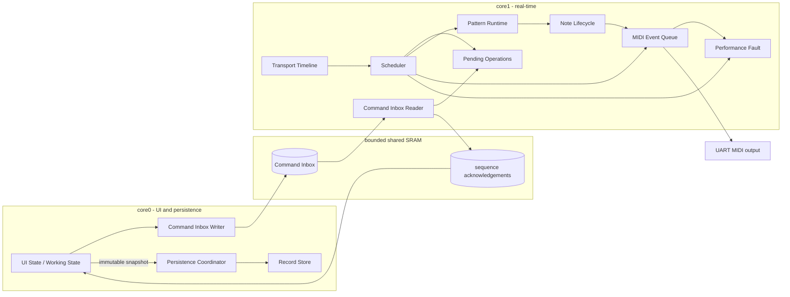

# Design Document: Performance-Safe Minimum Foundation

## Overview

Milestone 2 replaces GenSeq's cooperative best-effort sequencing loop with a bounded,
host-testable real-time architecture. It preserves the existing dual-core ownership model—UI
and persistence orchestration on core0, sequencing and MIDI scheduling on core1—but replaces
large blocking FIFO transactions with bounded shared-memory handoff and separates musical
intent from its quantized runtime application.

The design is driven by five invariants:

1. Every sounding note has a stable owner and a deterministic release path.
2. The global Transport Timeline remains authoritative under edits and bounded delays.
3. No scheduler, command, MIDI, or persistence queue can grow or block without a bound.
4. Saving cannot disturb MIDI timing and cannot destroy the previous valid record.
5. Any condition that cannot be reconciled safely fails closed and remains visible.

## Current-State Findings

The current implementation has useful seams but cannot satisfy the requirements unchanged:

- `Sequencer::update()` processes one overdue tick per call, creating catch-up bursts.
- `activeNotes[16][128]` collapses multiple owners and cannot remember the pitch that a Pattern
  started before an edit.
- Pattern removal, deactivation, and set replacement can strand notes.
- channel masking aliases API channels and cannot represent the intended 1–16 contract cleanly.
- `commands::sendGateSet()` can push 193 words through an eight-word blocking SIO FIFO.
- `commands::receiveCommand()` blocks for complete payloads and allocates vectors on core1.
- MIDI Start exists, but Clock is not emitted and Stop is not sent.
- `FlashStore` parks core1 and disables core0 interrupts during erase/program; its pause timeout
  is fail-open and therefore cannot provide transparent or safe saving.
- the host time stub always returns zero, so existing tests do not execute real tick behavior.

## Goals and Non-Goals

### Goals

- Deterministic, measurable scheduling and fault policy.
- Safe monophonic ownership per Pattern with overlapping-pattern support.
- Correct optional MIDI Start/Clock/Stop behavior.
- Full configurable meter within exactly representable PPQN limits.
- Immediate, beat, and bar operation boundaries.
- Bounded, nonblocking core-to-core communication.
- MIDI-transparent, transactional persistence with a measured backend decision.
- Repeatable host and RP2040 validation.

### Non-Goals

- New gate, pitch, velocity, or mutation algorithms.
- MIDI input, multiple MIDI outputs, MIDI routing, or MIDI CC generation.
- Final keyboard workflow or physical control layout.
- Scene and arrangement implementation.
- Gradual parameter morphing.

## Architecture



## Component Design

### 1. Monotonic Clock

Introduce an SDK-free clock interface so production scheduling can run against Pico time and
host tests can control time explicitly.

```cpp
class IMonotonicClock {
public:
    virtual ~IMonotonicClock() = default;
    virtual uint64_t nowMicros() const = 0;
};
```

`PicoMonotonicClock` adapts `get_absolute_time()` on firmware. `FakeMonotonicClock` advances
without sleeping on host. Scheduler logic depends only on integer microseconds and contains no
Pico SDK types.

### 2. Transport Timeline

`TransportTimeline` owns:

- BPM and PPQN.
- Time-signature numerator and denominator.
- absolute logical tick index.
- intended timestamp of the next tick.
- beat and bar indices/boundaries.
- running/stopped state.

The denominator is represented explicitly and validated against PPQN. With 24 PPQN, a beat of
`1 / denominator` whole notes contains `96 / denominator` ticks; unsupported denominators are
rejected rather than rounded. The design phase will select a bounded numerator range and a
power-of-two denominator set whose values divide 96 exactly.

A BPM change is staged at a defined boundary. The current phase is preserved and subsequent
tick durations use the new BPM. Fractional-microsecond error is carried with fixed-point or
remainder accumulation rather than discarded on every tick.

### 3. Pattern Runtime and Stable Identity

Runtime state is separated from editable configuration. Each live Pattern receives a stable
`PatternId` plus a generation value or equivalent stale-reference guard. Removing or reordering
another Pattern does not change that identity.

`PatternRuntime` contains fixed-capacity or preallocated sequence state plus:

```cpp
struct OwnedNote {
    bool sounding;
    uint8_t channel; // canonical protocol channel 0..15
    uint8_t note;
};
```

Pending commands and note ownership refer to `PatternId`, not vector position. UI ordering may
still use indices, but core0 resolves those indices to stable identities before publication.

### 4. Note Lifecycle

All note emission passes through one `NoteLifecycle` service. It holds:

- at most one current `OwnedNote` per monophonic Pattern runtime.
- an aggregate reference count for each channel/note pair.
- explicit `noteOn`, `releasePattern`, `releaseAll`, and `panic` operations.

For a retrigger of an already-owned wire key, every requested Note On is emitted. Releasing an
owner decrements the aggregate count; the final Note Off is emitted only when the count reaches
zero. This implements the approved independent-retrigger policy while preventing one Pattern
from prematurely releasing another.

A Pattern's falling edge releases its captured `OwnedNote`; it never asks mutable pitch state
which note to turn off. Mute/removal releases at the effective boundary. Set replacement keeps
the current ownership record until its original lifecycle ends.

### 5. Scheduler and Reconciliation

`Scheduler::service(nowMicros)` is the only component that advances musical time. It first
services immediate safety work, then determines lateness relative to the next intended tick.

Normal path:

1. Dispatch the due MIDI Clock byte when enabled.
2. Apply operations whose effective boundary is the current tick.
3. Advance active Pattern runtime state.
4. Produce note intents through `NoteLifecycle`.
5. Record dispatch lateness and schedule the next ideal tick.

The exact Clock/note ordering is fixed and host-tested. Clock is a MIDI real-time byte and may
be interleaved by the output layer without corrupting channel-message framing.

Reconciliation path for lateness below one beat:

- Calculate the target logical tick from elapsed monotonic time.
- Advance Pattern state through missed positions without emitting obsolete Note On events.
- Release a previously sounding note if its release boundary was crossed.
- Do not emit notes whose complete lifetime occurred inside the missed interval.
- Resume event emission at the first non-obsolete tick on the authoritative phase.

Lateness of one beat or more enters `PerformanceFault`. No loop attempts to replay every missed
tick through the MIDI port.

### 6. MIDI Event Queue

The output queue has fixed capacity and stores compact timestamped MIDI events. It provides:

- deterministic ordering for coincident events, using event priority and stable PatternId.
- priority/interleaving for single-byte MIDI real-time messages.
- reserved capacity or a bounded direct path for Note Off, Stop, and panic.
- current and high-water backlog metrics.
- detection of sustained overload.

Logical scheduling jitter is measured when the event reaches this layer. UART wire completion
is measured separately. If demand remains beyond wire capacity for one beat, the queue requests
a Timing Fault rather than retaining an unbounded backlog.

### 7. Pending Operations

A pending operation contains:

```cpp
struct PendingOperation {
    SequenceId sequence;
    PatternId target;
    OperationKind kind;
    TimingPolicy policy;
    uint64_t effectiveTick;
    PatternSnapshot payload;
};
```

Default policies are encoded centrally:

- immediate: Play, Stop, panic, audition, Keep, Undo.
- next beat: mute and unmute.
- next bar: committed set replacement and Pattern removal.

The global policy override resolves musical operations to Immediate, Next Beat, or Next Bar.
Safety operations ignore the override. Complete snapshots are swapped or copied atomically at
the boundary; partially decoded state is never visible to the scheduler.

### 8. Command Inbox

Replace multiword blocking FIFO frames with a fixed-capacity shared-SRAM inbox. The SIO FIFO may
carry a compact notification, but correctness does not depend on blocking payload transfer.

The inbox uses explicit producer/consumer ownership and acquire/release synchronization suitable
for RP2040. Each slot contains a complete fixed-capacity operation. Core1 drains only a bounded
number of operations between scheduler deadlines.

Coalescing uses a key such as `(PatternId, property, TimingPolicy)` and is allowed only before an
ordering barrier. Stop, panic, Pattern removal, snapshot barriers, and transport transitions are
never crossed. Every accepted sequence receives accepted/applied status so core0 can render
pending state and coordinate persistence.

### 9. Performance Fault

`PerformanceFault` is latched and contains a cause such as:

- scheduler lateness.
- MIDI output overload.
- command protocol violation.
- unrecoverable ownership inconsistency.

Entering the state is idempotent: halt new Pattern events, release ownership, emit Stop when
enabled, preserve Working State, and publish a fault event to core0. The LED matrix owns a
persistent fault presentation. An explicit Play acknowledges the fault, resets runtime
positions and pending invalid operations, and starts a new timeline.

### 10. Persistence Coordinator and Record Store

Working State on core0 remains the source of saved musical intent. Save captures an immutable
copy after Keep/commit semantics and excludes dirty audition drafts. Accepted quantized changes
are included even if core1 has not reached their effective boundary.

The current synchronous `IFlashStore::eraseAndProgram()` is too specific for transparent save.
Preserve backend isolation but introduce a bounded record-store operation or service state
machine that can report progress and completion without monopolizing the UI loop.

Every backend uses transactional record replacement. An A/B slot or equivalent generation and
commit-marker protocol keeps the previous valid record until the new record verifies.

#### Storage decision spike

Internal flash is instrumented first. It qualifies only if the complete scheduler/MIDI path can
continue safely from RAM and measured worst-case behavior meets both timing bounds. This path
must be auditable: every called function, constant, vtable, IRQ handler, and touched datum needed
while XIP is unavailable must be RAM-safe.

External FRAM is the leading fallback because it is byte-writable, erase-free, low latency, and
high endurance. The benchmark records capacity, worst-case write duration, bus occupancy,
component cost, pins, and driver complexity. External SPI NOR and EEPROM may be compared but do
not automatically satisfy deterministic latency.

Backend selection is an explicit review checkpoint before production persistence changes.

## Error Handling

| Condition | Behavior |
|---|---|
| Lateness below one beat | Reconcile without obsolete Note On events |
| Lateness at least one beat | Timing Fault |
| MIDI backlog sustained for one beat | Timing Fault |
| Inbox full | Coalesce, reject with status, or fault according to operation class; never block indefinitely |
| Stale PatternId/generation | Reject operation and retain current runtime state |
| Invalid meter/BPM/channel | Reject before publication |
| Save snapshot allocation/copy failure | Report save failure; no store write |
| Safe-write acknowledgement timeout | Abort; no destructive write |
| New record write/verify failure | Retain previous committed record |
| Timing Fault | Release notes, optional Stop, persistent matrix indication, explicit Play restart |

## Testing Strategy

### Host tests

- Fake-clock scheduler tests at boundary, early, late, reconciliation, and fault timestamps.
- Meter properties across every supported numerator/denominator and representative BPM.
- MIDI Start/Clock/Stop byte streams with output enabled and disabled.
- Model-based note ownership traces covering overlap, retrigger, mutation, mute, remove, Stop,
  repeated Play, and fault.
- Pending-operation tests immediately before, on, and after beat/bar boundaries.
- Inbox stress tests for fixed capacity, coalescing, barriers, stale sequences, and saturation.
- Allocation instrumentation proving zero steady-state allocation on timing-critical paths.
- Save-snapshot tests covering drafts, accepted pending changes, mutation after capture, timeout,
  and transactional failure.
- Sanitizer runs for ownership and payload lifetimes.

Required tests must be CTest-visible. Property-test dependencies must be pinned or replaced with
an always-available deterministic generated-trace runner; required coverage may not silently
skip because network access is unavailable.

### Hardware tests

Use a logic analyzer on MIDI TX GPIO8 plus one or more compile-time trace GPIOs. Capture tick
service, MIDI enqueue/write, operation application, save begin/end, and fault transitions.

Test BPM 40, 120, and 255; minimum and maximum Pattern load; coincident notes; edit storms;
Stop/mute/remove/replacement; repeated saves; and intentional overrun/overload injection.

Report separately:

- intended versus actual logical dispatch jitter.
- deterministic DIN MIDI wire serialization skew.
- UI/input service gaps.
- save duration and storage-operation phases.
- maximum command and MIDI queue occupancy.

Milestone evidence includes test commands, seeds, firmware revision, analyzer setup, captures,
decoded MIDI output, benchmark tables, and the storage decision record.

## Implementation Sequence

1. Add controllable time and baseline instrumentation.
2. Centralize note lifecycle and stable Pattern identity.
3. Introduce Transport Timeline, scheduler recovery, Clock/Stop, and fault state.
4. Add bounded MIDI output serialization and overload detection.
5. Replace blocking command payloads and add quantized operation application.
6. Make save capture asynchronous and benchmark storage alternatives.
7. Implement transactional storage with the selected backend.
8. Integrate matrix fault feedback and run the complete host/hardware gate.
