# GenSeq User Manual

GenSeq is a standalone generative MIDI sequencer. It plays up to 15 patterns at
once on its MIDI output. Each pattern combines three sets: a **gate set** (the
rhythm), a **pitch set** (the notes) and a **velocity set**. The sets live in
three libraries of 16 sets each, and a pattern simply points at one set of each
kind. Several patterns can use the same set, for example three patterns playing
the same melody in three different rhythms. Editing a set changes it for every
pattern that uses it.

Patterns reach the MIDI output through **Instruments**. An Instrument has one
MIDI channel and a selection of patterns that play on it, so "bass on channel 2"
and "drums on channel 10" are two Instruments. A pattern can belong to several
Instruments and then plays the same notes on each of their channels. You can
switch a pattern off in one Instrument only, mute a whole Instrument, or stop a
pattern everywhere (section 4a).

On top of that, the sets carry **generation parameters** that shape the material
while it plays: step probability (gate set), a scale constraint (pitch set),
velocity humanization, a deterministic seed and stream coupling (velocity set).

This manual covers firmware milestone M3 (generative engine expansion) with
shared sets.

## 1. Connecting

| Connection | Purpose |
|---|---|
| USB keyboard | The control surface. Every action is a key press. Holding a key repeats it. |
| MIDI OUT (5-pin DIN) | Notes plus MIDI Clock, Start and Stop for your synth or drum machine. Each Instrument sends on its own MIDI channel (1-16). |
| Power (USB) | Powers the device. Your setup is kept across power cycles once you save it. |

GenSeq starts in the INSTRUMENTS view (label `cNN`, your channel) with your last
saved setup; press **F3** to go to PATTERNS. On the very first boot (nothing saved
yet) it starts with one Instrument on channel 1 playing one default pattern at
120 BPM.

## 2. The display

The 16×16 LED matrix shows one view at a time. Editor views all use the same
layout:

```
 rows 0-4   LABEL  (yellow)   which field you are editing, e.g. Prb, Scl, Hmn
            status pixels in the top-right corner (see below)
 rows 6-10  VALUE  (green)    the field's current value: a number, a note or text
```

Numbers always show three digits (`050` = 50). Notes show the letter on the
left, the octave on the right, and a single dot at the right edge for a sharp
(`C#4` = letter C, dot, digit 4).

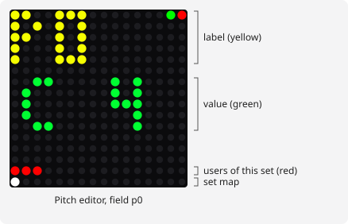

The picture shows the pitch editor on field `p0` (note C4) with a scale active. All screenshots in this manual are rendered from the firmware's own display code.

**Status pixels** (top row, right side):

| Pixel | Meaning |
|---|---|
| (15,0) red | You have an uncommitted change in this editor. Enter keeps it, Esc undoes it. |
| (14,0) green / red | Pitch editor only, when a scale is active: the shown pitch is in / out of the scale. |
| (13,0) green / dim red | Gate grid only: the selected step's gate is on / off. |

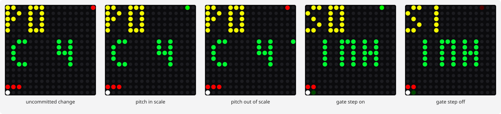

**Set rows** (the two bottom rows, in the GATE, PITCH and VELOCITY editors):

| Row | Meaning |
|---|---|
| 15 | **Set map**: one pixel per set of this kind, set 0 at the left, set 15 at the right. Dim green = the set exists, white = the set you are editing, dark = free. |
| 14 | **Users**: one red pixel per pattern that uses the set you are editing, pattern 1 at the left. Two or more red pixels mean the set is shared, and your edit changes all of those patterns. No red pixel means no pattern uses it. |

A short word in the value area answers a set action that was refused (see
section 5). It disappears at your next key press.

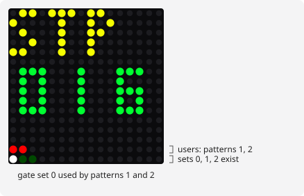

In this example gate set 0 is used by patterns 1 and 2 (two red pixels), and three gate sets exist (set 0 is white).

**Save banners** fill the whole matrix for 1.5 seconds:

| Colour | Meaning | Onboard LED |
|---|---|---|
| Green | Save succeeded | on |
| Red | Save failed. Your setup is still active, just not stored. | fast blink |
| Yellow | At boot: a saved setup was found but could not be loaded. GenSeq started with defaults. | slow blink |

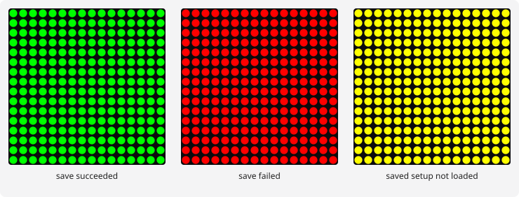

## 3. Global keys

These work in every view.

| Key | Action |
|---|---|
| Space | Play / Stop. Play always starts every pattern from its first step. Stop releases every sounding note. |
| Ctrl+S | Save the whole setup (patterns, sets, BPM, all parameters) to memory. Playback keeps running. |
| F1 | SETTINGS view (tempo) |
| F2 | INSTRUMENTS view (channels, mute, which patterns each Instrument plays) |
| F3 | PATTERNS view |
| F4 | GATE editor of the selected pattern's gate set |
| F5 | PITCH editor of the selected pattern's note set |
| F6 | VELOCITY editor of the selected pattern's velocity set |

The keys follow the structure of the instrument: settings, Instruments, patterns,
then the sets of a pattern. F4 to F6 do nothing when no pattern is selected (the
add slot) or when that editor is already open. F7 to F12 are not used yet.

## 4. PATTERNS view (F3), label `PTN`

The overview of all patterns. Each pattern is a small square in a grid of 5
columns by 3 rows (pattern 1 top-left, reading order).

- **Red square:** a pattern that belongs to the Instrument selected in the
  INSTRUMENTS view. A pattern that does not belong to it shows only its top-left
  pixel. A **magenta pixel** in the top-right corner marks a pattern that belongs to
  no Instrument at all: it is silent.
- **Yellow line:** the empty "add" slot after the last pattern.
- **White pixel:** the selection. Its corner inside the selected square says which
  stream you will open: top-left = GATE, top-right = PITCH, bottom-left = VELOCITY.
- **Bottom three rows:** which sets the selected pattern uses. Row 13 is the gate
  library, row 14 the pitch library and row 15 the velocity library, set 0 at the
  left. Dim green = the set exists, white = the set this pattern uses.

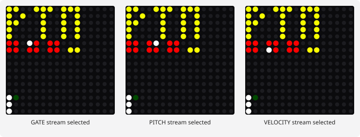

Here pattern 2 is selected. The white pixel moves inside its square to show the stream: top-left GATE, top-right PITCH, bottom-left VELOCITY. In row 13 (gate library) set 1 exists but pattern 2 uses set 0 (white); the pitch and velocity libraries each hold only set 0.

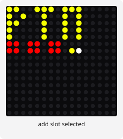

With the add slot selected, the white pixel sits in the slot's lower-right corner and Enter adds a pattern.

| Key | Action |
|---|---|
| Ctrl+Left / Ctrl+Right | Select the previous / next pattern |
| Ctrl+Up / Ctrl+Down | Select the pattern one row up / down |
| Up / Down / Left / Right | Choose the stream: from GATE, Right = PITCH and Down = VELOCITY; Left or Up returns to GATE |
| Shift+Left / Shift+Right | Switch the selected stream of this pattern to the previous / next existing set (wraps around). You hear the change at once; the pattern keeps its place in the bar. |
| Enter | Open the editor on the set this pattern uses for the selected stream. On the add slot: add a new pattern. |
| Delete | Delete the selected pattern. Its sets stay in the libraries. |

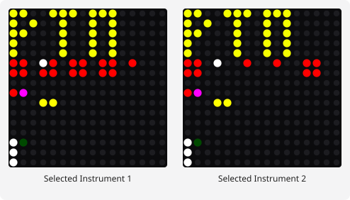

Six patterns: with Instrument 1 selected (left), patterns 1 to 4 are full squares and
pattern 5 shows only its top-left pixel. With Instrument 2 selected (right) only
patterns 1 and 5 are full squares. Pattern 6 belongs to no Instrument, so it has
the magenta pixel in both pictures.

A **new pattern** starts on the lowest-numbered existing set of each kind, so at
first it shares those sets with other patterns. To give it its own material, see
"Giving a pattern its own set" in section 5.

## 4a. INSTRUMENTS view (F2), label `cNN`

The label shows the MIDI channel of the selected Instrument, for example `c01` for
channel 1 (red while the Instrument is muted). Below it is the same 5-by-3 grid of
patterns as in the PATTERNS view, and the bottom row is the **Instrument strip**:
one pixel per Instrument slot (dark = free, dim blue = Instrument, dim red = muted
Instrument, white = the selected one).

A pattern square says how that pattern relates to the selected Instrument:

| Square | Meaning |
|---|---|
| Green | Assigned, route on, pattern active: it sounds on this channel. |
| Blue | Assigned, route on, but the pattern itself is stopped. |
| Top row red, bottom row dark | Assigned, but its **route is off**: it stays in the Instrument and is silent here only. |
| Faint grey | Not in this Instrument. |
| (dark) | No such pattern. |

Two white pixels under a square are the cursor. A muted Instrument is drawn at half
brightness.

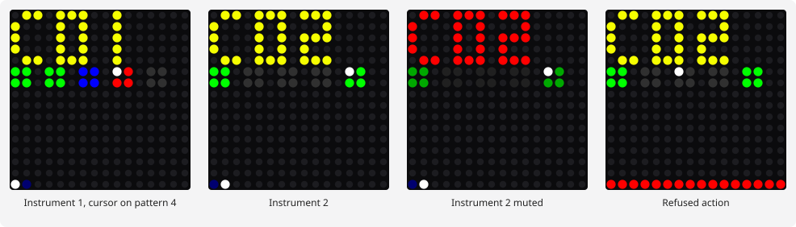

Five patterns and two Instruments. Instrument 1 (channel 1) plays patterns 1 to 4:
pattern 3 is stopped (blue) and the route of pattern 4 is off (cursor under it).
Instrument 2 (channel 2) plays patterns 1 and 5, so pattern 1 sounds on both
channels. Third picture: Instrument 2 muted. Fourth picture: the strip turns red
when an action is refused; it clears at your next key.

| Key | Action |
|---|---|
| Arrow keys | Move the cursor over the patterns |
| Ctrl+Left / Ctrl+Right | Select the previous / next Instrument |
| Enter | Add the pattern under the cursor to the Instrument, or remove it |
| E | Switch the route of that pattern in this Instrument on or off |
| M | Mute or unmute the Instrument |
| Shift+Left / Shift+Right | Change the Instrument's MIDI channel (channels used by another Instrument are skipped; no wrap-around) |
| Ctrl+N | New Instrument on the lowest free channel (16 at most) |
| Delete | Delete the selected Instrument (not the last one). Its patterns stay and are silent if no other Instrument plays them. |

**Three switches decide whether a note sounds.** It sounds on a channel only if all
three allow it:

1. the **pattern** is active (a pattern is active from the moment it is created;
   this version has no key to stop one, so use the route switch or the mute),
2. the pattern's **route** in that Instrument is on (key E),
3. the **Instrument** is not muted (key M).

Changing one switch never changes the others. Unmuting an Instrument brings back
exactly the routes that were on.

**What a shared pattern does.** A pattern plays one note per step, and every
Instrument that plays it sends that same note, with the same velocity and length, on
its own channel. The pattern has one position, not one per Instrument, and a pattern
with random elements draws the same random numbers whether it plays on one
channel, several or none, so a seeded pattern repeats exactly in all cases.
Switching a route on again resumes the pattern where it is, in step with the rest.

**Changing things while playing.** Muting, switching a route off, removing a
pattern from an Instrument, changing a channel and deleting an Instrument all
release the sounding notes of the affected channel at once (the Note Off goes to
the channel the note was started on), so nothing is left hanging.

**MIDI bandwidth and the load pixel.** The DIN MIDI cable carries about 3,100 bytes a
second, about 1,000 three-byte messages. Every note on N channels sends N Note On and N Note
Off messages, so a pattern shared by many Instruments uses N times the bandwidth, and those
notes are all due at the same moment. GenSeq buffers them and sends them one after the other,
so a burst comes out as a short smear (a few milliseconds per note) instead of breaking the
rhythm. MIDI Clock bytes are sent ahead of the buffered notes, so a synced device stays in time.

The pixel at the right end of row 4 (column 16) shows the load in every view:

| Pixel | Meaning |
|---|---|
| off | Normal. |
| amber | In the last 2 seconds a note waited 10 ms or more on the cable: big chords or many shared routes are smearing. |
| red | Overload: the cable could not keep up for a whole beat. GenSeq stopped, released every note and sent MIDI Stop. |

GenSeq stops (red) once a note would leave the cable a quarter of a second (250 ms) or more
late. Shorter surges only smear the timing and show amber. After a red pixel, reduce the load
(mute an Instrument, switch routes off) and press **Space** to play again; the pixel goes off.
Measured with 6 patterns that each play every sixteenth note at 140 BPM, all in every
Instrument: 10 Instruments play for 30 seconds without stopping (amber from 2 Instruments on,
notes at most about 90 ms late), 12 Instruments stop after about half a minute, 16 within a few
seconds. Lighter or less uniform patterns leave room for more.

## 5. Sets and sharing

There are three libraries: 16 gate sets, 16 pitch sets and 16 velocity sets,
numbered 0 to 15. The GATE, PITCH and VELOCITY editors always edit **a set**, not
a pattern. They open on the set that the selected pattern uses, and the set rows
at the bottom of the display (section 2) show which set that is and which patterns
use it.

These keys work in all three editors:

| Key | Action |
|---|---|
| Ctrl+Left / Ctrl+Right | Edit the previous / next existing set of this kind (wraps around) |
| Ctrl+N | Create a new set with default content and edit it |
| Ctrl+D | Copy the set you are editing into a new set and edit the copy |
| Ctrl+Delete | Delete the set you are editing |
| Ctrl+G | Go to a pattern that uses this set |

Switching sets, Ctrl+N and Ctrl+D undo an uncommitted change first, just like
leaving the editor. Ctrl+D copies the last committed version. Creating, copying
and deleting a set never changes which sets the patterns use.

**Refused actions.** The value area shows a short word instead:

| Word | Meaning |
|---|---|
| `ful` | The library already holds 16 sets. Delete an unused one first. |
| `use` | The set cannot be deleted because a pattern uses it. Switch those patterns to another set first. Every library keeps at least one set, because there is always at least one pattern using it. |
| `unu` | Ctrl+G: no pattern uses this set. |

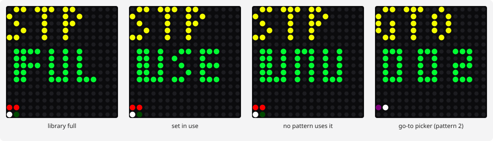

The last picture is the Ctrl+G picker (`gto`) with patterns 1 and 2 as candidates (pattern 1 dim purple, the highlighted pattern 2 white); the number shows the highlighted pattern.

**Editing a shared set.** Two or more red pixels in row 14 mean the set is
shared, so every change you make is heard on all of those patterns at once. The
patterns still run independently: each one keeps its own position in the set and,
in `Rnd` order, its own random sequence. Because the generation parameters belong
to the sets, patterns that share a set also share them. For example, patterns
using the same pitch set share its scale.

**Go to a pattern (Ctrl+G).** If exactly one pattern uses the set, GenSeq jumps
straight to it in the PATTERNS view. If several do, a picker opens: the label
reads `gto`, the number is the pattern (pattern 1 = `001`), and row 14 shows every
pattern that uses the set, the highlighted one in white. Left/Right (or Up/Down)
moves between them, Enter goes to the highlighted pattern, Esc closes the picker
and leaves your editing untouched. Going to a pattern undoes an uncommitted
change, like leaving the editor.

**Giving a pattern its own set.**

1. In PATTERNS, select the pattern and the stream, then press Enter to open its set.
2. Press **Ctrl+D**. The editor now shows a copy (a new white pixel in row 15) that
   no pattern uses yet.
3. Edit the copy and press Enter to commit it.
4. Press Esc to return to PATTERNS and use **Shift+Right** (or Shift+Left) until
   row 13, 14 or 15 shows the copy in white for this pattern.

**Example: one melody, three rhythms.** Add three patterns. They start on the same
sets. Give patterns 2 and 3 their own gate sets as above and make the three rhythms
different. Leave all three on the same pitch set: every melody edit is now heard in
all three rhythms.

## 6. How editors work

Every editor works the same way:

- **Left / Right** moves between fields. The label tells you where you are.
- **Up / Down** changes the value. Hold **Shift** for big steps (×10 for numbers,
  an octave for pitches).
- Changes are **heard immediately** while you edit, so you can tune by ear.
- **Enter** commits: the change becomes part of the set, for every pattern that uses it
  (and is included in the next save).
- **Esc** undoes everything since the last Enter. Press Esc again (with nothing to
  undo) to go back to PATTERNS. Leaving an editor any other way also undoes
  uncommitted changes.

Each generation parameter has a "neutral" value that switches the feature off
(probability 100, scale `cro`, humanize 0, seed `off`, coupling `Ind`). A pattern
with every parameter neutral plays exactly like a plain step sequence.

## 7. GATE editor (the rhythm)

Opens on `Alg`. Fields from left to right:

| Label | Value | Meaning |
|---|---|---|
| `Alg` | `euc` | Rhythm generator. Euclidean is the only one in this version. |
| `StP` | 1–64 | Steps in the pattern |
| `PLS` | 0–steps | Pulses: how many steps are hits. They are spread as evenly as possible (Euclidean). |
| `rot` | 0–steps-1 | Rotation: shifts the hits around the pattern |
| `nLn` | 32, 16, 8, 4, 2, 1 | Step length as a note value: 16 = sixteenth notes, 4 = quarter notes |
| `LEn` | 0–100 | Gate length, percent of a step that the note is held |
| `Prb` | 0–100 | **Step probability** for the whole pattern, in percent. 100 = every hit plays; 50 = each hit has an even chance; 0 = silent. |
| `s0`, `s1`, ... | grid | **Per-step grid**, one field per step (up to 16) |

**The per-step grid.** Moving right from `Prb` enters the grid at step `s0`.
Left/Right walks the steps; Left from `s0` goes back to `Prb`.

- **Enter** toggles the selected step's gate on or off (pixel (13,0) green = on).
  Because Enter toggles on the grid, move Left onto `Prb` (or any other field)
  and press Enter there to commit.
- **Up / Down** sets this step's own probability: `inh`, 0, 10, 20 ... 100.
  `inh` (inherit) means "use the pattern's `Prb`". Any number overrides `Prb` for
  this step only. Example: `Prb 50` with step 0 at 100 gives a solid downbeat and
  a sparse rest of the bar.

Changing `StP`, `PLS` or `rot` regenerates the gate pattern, but keeps every
per-step probability you set.

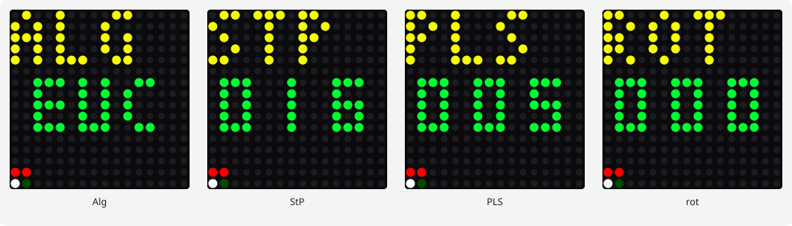

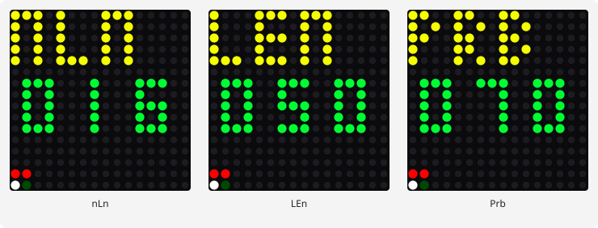

The per-step grid for three steps (the green pixel at top right is the gate indicator, dark red = gate off):

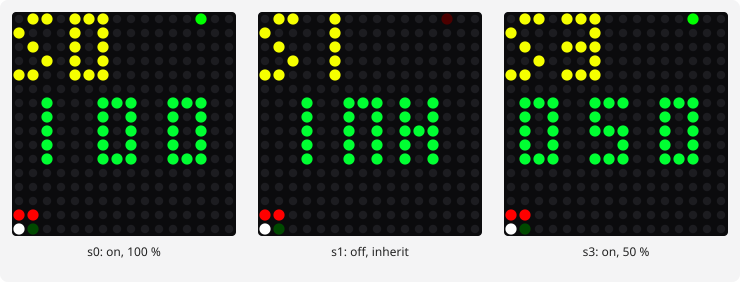

## 8. PITCH editor

Opens on `Cnt`. The scale fields are to the left of it, the pitches to the right.

| Label | Value | Meaning |
|---|---|---|
| `Scl` | `cro`, `maj`, `min` | **Scale constraint**: chromatic (off), major, natural minor |
| `rut` | C ... B | Root of the scale (sharp dot for C#, D#, F#, G#, A#) |
| `qnt` | `nea`, `dwn`, `up`, `skp` | What happens to a pitch outside the scale: snap to the nearest scale note, snap down, snap up, or skip the step (silent) |
| `Cnt` | 1–16 | How many pitches are in the set |
| `Ord` | `Fwd`, `Bwd`, `Pnd`, `Rnd` | Playing order: forwards, backwards, pendulum, random |
| `p0`, `p1`, ... | note | The pitches. Up/Down = semitone, Shift = octave. |

The scale constraint changes what is **played**, never what is **stored**: your
pitch set stays as you entered it, and turning the scale back to `cro` restores
it exactly. While a scale is active, the pixel at (14,0) shows whether the pitch
you are looking at is in the scale (green) or will be changed (red).

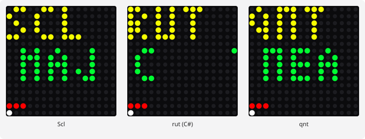

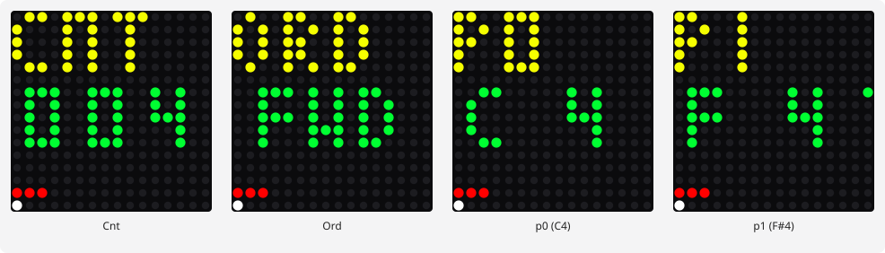

The examples show a C# major scale constraint (`Scl`, `rut`), then plain pitches C4 and F#4 (sharp dot at the top right).

## 9. VELOCITY editor

Opens on `Cnt`. The generation fields for humanize, seed and coupling are to the left of it.

| Label | Value | Meaning |
|---|---|---|
| `Hmn` | 0–64 | **Humanization**: each note's velocity varies randomly by up to ± this amount. Results stay between 1 and 127. |
| `Sed` | `off`, 0, 1, 2 ... | **Deterministic seed** for the patterns using this set (see below) |
| `Cpl` | `Ind`, `Lck` | **Coupling**: `Ind` = velocity set runs on its own; `Lck` = each pitch position always gets the same velocity |
| `Cnt` | 1–16 | How many velocities are in the set |
| `Ord` | `Fwd`, `Bwd`, `Pnd`, `Rnd` | Playing order |
| `v0`, `v1`, ... | 0–127 | The velocities |

**Seed.** Everything random in a pattern (step probability, humanization and
`Rnd` playing order) comes from that pattern's random generator.

- With `Sed off`, the pattern is different every time you press Play.
- With a seed number, the pattern plays **the same "random" performance every
  time**: after Stop and Play, after saving, and after a power cycle. Different
  numbers give different performances. Changing the seed while playing restarts
  the sequence from that seed.
- From `off`, Up gives seed 0; below 0 goes back to `off`.
- The seed belongs to the velocity set, so patterns that share a velocity set use
  the same seed number. Each pattern still runs its own copy of the generator.

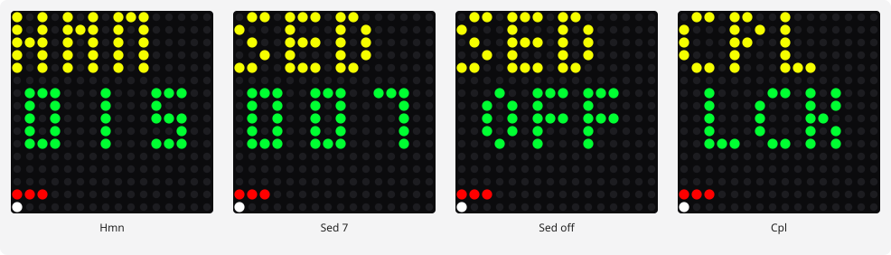

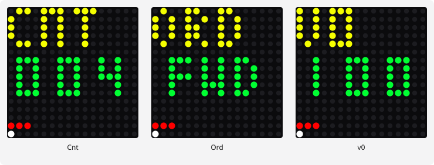

**Coupling** matters when the pitch and velocity sets have different lengths.
With 4 pitches and 3 velocities, `Ind` lets the accents drift across the melody
(a 12-step cycle), while `Lck` ties velocity to the pitch position so the first
pitch is always accented the same way.

## 10. SETTINGS view (F1), label `bPM`

Up/Down changes the tempo by 1 BPM, Shift+Up/Down by 10. Range 40–255. The change
applies immediately and is included in the next save.

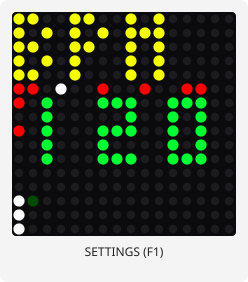

## 11. Saving and loading

- **Ctrl+S** stores the complete setup: patterns, all sets (also the ones no
  pattern uses), which sets each pattern uses, all generation parameters, the
  Instruments (channel, mute, which patterns, which routes are on) and the tempo. Patterns that shared a set before saving still share it after loading.
  Only committed values are saved, so press Enter in an open editor first.
- Saving does not interrupt playback.
- At power-up GenSeq loads the last save automatically. If nothing was saved it
  starts with defaults silently. If a save exists but cannot be read, the yellow
  banner appears and defaults are used.
- **Saves from earlier firmware** (before shared sets) load normally: every pattern
  gets its own gate, pitch and velocity set, numbered like the pattern (pattern 1
  uses set 0 of each kind, pattern 2 set 1, and so on), and plays exactly as before.
  The next Ctrl+S writes the new format. Firmware from before shared sets cannot
  read that format and starts with defaults, so keep the old firmware file if you
  might go back.
- **Saves from firmware before Instruments** also load normally: they stored a MIDI
  channel per pattern, so GenSeq creates one Instrument per channel in use (lowest
  channel first), puts the patterns that used it into it with every route on and
  nothing muted, and the output sounds exactly as before. Firmware from before
  Instruments cannot read a save written by this version.
- A saved setup that is inconsistent (for example two Instruments on one channel) is
  treated like an unreadable save: the yellow banner appears and defaults are used.

## 12. Quick start

1. Connect MIDI OUT to a synth on channel 1 (the default Instrument), press **F3**
   (PATTERNS) and then **Space**. You hear the
   default pattern: four notes (C4 G4 A4 C5) on a 4-of-16 Euclidean rhythm.
2. **Enter** opens the gate editor: Right twice to `PLS`, Up to add hits.
3. Right to `Prb`, Down to 70: the rhythm starts to breathe. Press Enter.
4. **Esc, Right, Enter** opens the pitch editor: Left three times to `Scl`, Up to
   `maj`. Now edit the pitches freely (Right to `p0` ...): they always land in C major.
5. In the velocity editor set `Hmn` to 15 for a looser feel, then `Sed` to a number
   once you like what you hear. Press Enter.
6. **Ctrl+S** to keep it.
7. To hear the melody in a second rhythm: Ctrl+Right to the add slot and Enter. The
   new pattern starts on the same sets, so it plays in unison. Choose its gate stream
   (Left or Up) and press Enter, then **Ctrl+D** to copy the gate set. Go Right twice
   to `PLS`, change it and press Enter. Then Esc and **Shift+Right** switch the pattern
   to the copy (section 5). Both patterns still share the pitch set, so every note you
   change is heard in both rhythms.

## 13. Not in this version

- A key to stop a single pattern everywhere (the pattern's own active switch). Use the
  route switch (E) in one Instrument, or mute the Instrument. Delete removes a pattern.
- Names for Instruments. Instruments are known by their MIDI channel.
- Two Instruments on one MIDI channel. To play two parts on one channel, put both
  patterns into one Instrument.
- Rhythm generators other than Euclidean.
- Names for sets. Sets are known by their number (0–15) in the set rows.

## Regenerating the screenshots

The pictures in `docs/user/img/` are generated from the firmware's view code by `tools/manual_screens/build.sh`. Re-run it after changing a view.
